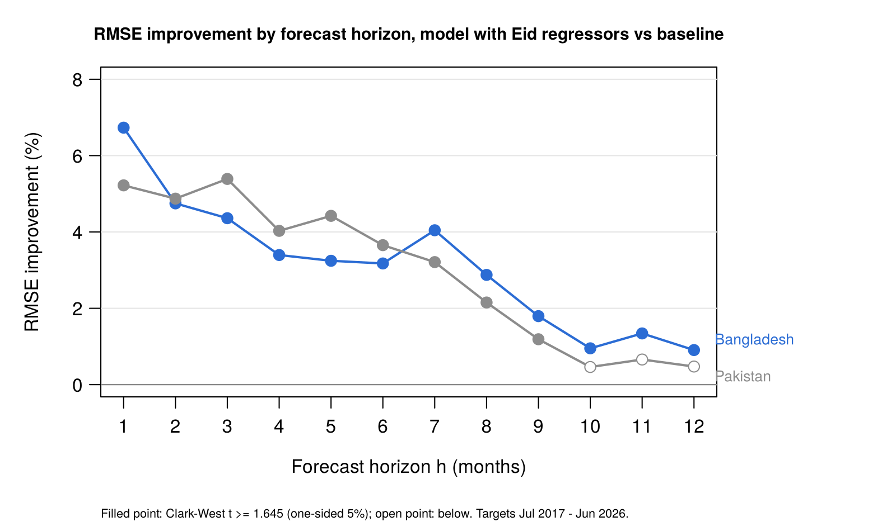

# Islamic-Calendar Effects and Remittance Forecasting: Comparative Evidence from Bangladesh and Pakistan

Draft paper sections, 4 Nov 2026. Source of numbers: `results/` (corrected run; see `results/REPORT.md`). Editable copy: the Claude doc of the same title.

## 1. Research questions and objectives

The study asks whether the two Eid holidays are associated with changes in monthly workers' remittances to Bangladesh and Pakistan, and whether accounting for them improves out-of-sample forecasts.

### Research questions

**RQ1 (effect estimation).**

- Are Eid al-Fitr and Eid al-Adha associated with changes in monthly workers' remittances in Bangladesh and Pakistan?
- Do the size and direction of these effects differ between the two countries?

**RQ2 (forecasting value).**

- Do Eid regressors improve out-of-sample forecasts of monthly workers' remittances in each country?
- Secondary: do the effects and any forecast improvement hold across periods and training-window strategies?

### Objectives

1. Construct monthly Eid regressors for each country from its own national Eid dates.
2. Estimate the effects of Eid al-Fitr and Eid al-Adha on log remittances in each country with a regression model with SARIMA errors (RegARIMA).
3. Test whether the Eid effects differ between Bangladesh and Pakistan, and whether they changed after July 2020.
4. Compare out-of-sample forecasts from a baseline model and the same model with Eid regressors, using a rolling-origin evaluation, at horizons of 1 to 12 months.
5. Compare both models with two benchmarks: a seasonal naive forecast and a Box–Jenkins SARIMA model.
6. Examine whether the results depend on the training-window strategy, the evaluation period, the Eid window definition, the source of the Eid dates, the model orders and the treatment of interventions.

## 2. Data and methodology

Both countries are analysed with identical code: a RegARIMA model on log remittances, a pre-specified intervention rule, and a rolling-origin forecast evaluation on the same target months.

### 2.1 Data

| | Bangladesh | Pakistan |
| --- | --- | --- |
| Source | Bangladesh Bank, *Monthly Economic Trends*, Table XVIII; each month taken from the latest issue that prints it | State Bank of Pakistan, workers' remittances; to Dec 2024 from the SBP release file (printed 9 Jan 2025), from Jan 2025 from SBP bulletins and press figures |
| Series | Workers' remittances, US$ million, not seasonally adjusted | Workers' remittances, US$ million, original (not seasonally adjusted) series |
| Primary span | Jul 2009 – Jun 2026 (204 months) | Jul 2005 – Jun 2026 (252 months) |
| Excluded from the primary span | Jul 2026 (single vintage) | Jul – Sep 2026 (first releases; Aug 2026 derived); used in sensitivity S9 only |
| Transformation | Natural log | Natural log |

Each country's full span is primary. The common window, Jul 2009 – Jun 2026, is used only as a sensitivity check for the cross-country test (S10). Levels are never compared across countries; comparisons use percentage effects and within-country forecast accuracy. The SBP seasonally adjusted series is not used, because its adjustment method is not documented and may already remove Eid effects.

### 2.2 Eid dates and Eid regressors

**Dates.** Each country's own national Eid dates are used, taken from news reports of the national moon-sighting announcements, with a source recorded for each event. Where no date could be sourced, the Umm al-Qura date is used and flagged.

| | Bangladesh | Pakistan |
| --- | --- | --- |
| Eid events in the primary span | 36 | 44 |
| Sourced from national announcements | 34 (3 from photo captions) | 34 |
| Umm al-Qura fallback | 2 | 10 |

**Regressors.** Two regressors, one per Eid. For month *t*, each equals the share of the 21-day window ending on Eid day (inclusive) that falls in month *t*. A window entirely inside one month gives 1 in that month; a window split across two months is divided between them. The regressors capture the pre-holiday sending period, which moves through the Gregorian calendar by about 11 days a year.

Sensitivity variants: 10-day and 30-day windows; a 21-day window ending the day before Eid; and Umm al-Qura dates.

### 2.3 Model

RegARIMA on log remittances:

```latex
\log Y_t = \beta_0 + \beta_F \, \mathrm{Fitr}_t + \beta_A \, \mathrm{Adha}_t + \gamma' Z_t + \varepsilon_t, \qquad \varepsilon_t \sim \mathrm{SARIMA}(p,d,q)(P,D,Q)_{12}
```

*Z* holds the intervention regressors (Section 2.4). With differenced errors, a drift replaces the linear trend; it is included only when d + D = 1.

Two models are compared:

- **Baseline:** *Z* only, with no Eid regressors.
- **Model with Eid regressors:** *Z* plus Fitr and Adha, with identical orders, training data and interventions.

**Order selection.** Orders are chosen by `auto.arima` on the baseline model, given *Z*: exhaustive search (no stepwise search or approximation), p, q ≤ 3, P, Q ≤ 1, d by the KPSS test, D by the default seasonal test, AICc as the criterion. The same orders are then used for the model with Eid regressors.

**Effects** are reported as percentage changes, 100·(exp(β) − 1), with 95% confidence intervals from the Hessian standard errors.

### 2.4 Intervention rule

An intervention enters the model only if all three conditions hold:

1. **External reason.** It is on a candidate list fixed in advance, with a dated reason for each entry.
2. **Support in the data.** It is detected on the model with Eid regressors.
3. **Inside the training window.** At least 3 observations after its date lie in the training window.

The selected set is then used in both models of the pair.

**Candidate list**

| ID | Country | Window | External reason |
| --- | --- | --- | --- |
| B1 | Bangladesh | Jul 2019 | 2% cash incentive on remittances through formal channels takes effect |
| B2 | Bangladesh | Mar – Jul 2020 | COVID-19: lockdowns, migrant job losses, disruption of informal (hundi) channels |
| B3 | Bangladesh | Jan 2022 | Incentive raised from 2% to 2.5% |
| B4 | Bangladesh | Sep 2022 | Cap on the remittance exchange rate; gap with the kerb market widens |
| B5 | Bangladesh | Aug – Oct 2024 | Change of government (5 Aug 2024); rise in remittances through formal channels |
| P1 | Pakistan | Oct 2008 – Jan 2009 | Global financial crisis shock to Gulf labour markets |
| P2 | Pakistan | Apr – Jun 2009 | Pakistan Remittance Initiative launched |
| P3 | Pakistan | Jul 2016 | Contraction of the Gulf labour market |
| P4 | Pakistan | Mar – Jul 2020 | COVID-19 |
| P5 | Pakistan | Sep 2022 | Widening gap between interbank and open-market exchange rates |
| P6 | Pakistan | Sep 2023 | Crackdown on currency smuggling and the kerb market |

**Detection and selection** (for the full-sample fits and at every forecast origin):

1. Fit the model with Eid regressors with airline errors, SARIMA(0,1,1)(0,1,1)₁₂.
2. For each month in an eligible candidate window, add one regressor of each type in turn — additive outlier (AO), temporary change (TC, decay 0.7) and level shift (LS) — and record its t-statistic.
3. Critical value: cval(n) = 3 for n ≤ 50, 4 for n ≥ 450, and 3 + 0.0025(n − 50) in between, where n is the number of training observations (the `tsoutliers` default).
4. Forward selection: add the month and type with the largest |t| ≥ cval, refit, and repeat until none passes. Each candidate window contributes at most 2 interventions.
5. Choose the orders on the baseline with the selected interventions (Section 2.3).

### 2.5 RQ1: estimation and tests

- **Full-sample fit.** One fit per country over the primary span, with interventions and orders chosen as above.
- **Cross-country test.** For each Eid, H0: β_BD = β_PK, using z = (β̂_BD − β̂_PK) / √(se_BD² + se_PK²), treating the two fits as independent. Sensitivity S10 refits both countries on the common window and subtracts 2ρ̂·se_BD·se_PK from the variance, where ρ̂ is the correlation of the two models' innovations.
- **Temporal stability.** Interaction terms Fitr×Post and Adha×Post, with Post = 1 from Jul 2020 (start of FY2020-21), tested jointly by a Wald test.
- **Diagnostics.** Ljung–Box test at lag 24, residual ACF and Jarque–Bera test.

### 2.6 RQ2: forecast evaluation

**Design.** Rolling-origin evaluation with an expanding training window. The first forecast origin is Jun 2017 for both countries, so both are evaluated on the same target months, Jul 2017 – Jun 2026. At each origin, interventions and orders are re-selected, both models are fitted, and forecasts are made for h = 1, …, 12 months.

**Horizons.** h = 1 and 3 are the focal horizons; h = 6 and 12 are supplementary. All horizons are reported.

**Errors and accuracy measures.** Forecast errors are on the log scale. Measures: RMSE, MAE, mean error (bias), and MASE scaled by the in-sample seasonal naive MAE of each training window. Level-scale RMSE and MAPE are also reported, using exp(log ŷ) as the point forecast. Improvement % = 100·(loss of baseline − loss of model with Eid regressors) / loss of baseline.

**Tests.**

| Test | Role | Details |
| --- | --- | --- |
| Clark–West | Primary (the models are nested) | Squared error on the log scale; one-sided; Newey–West variance with h − 1 lags; Holm correction over 4 tests (2 countries × h = 1, 3) at α = 0.05 |
| Diebold–Mariano | Secondary | Absolute-error loss; Harvey–Leybourne–Newbold correction; two-sided; no multiplicity correction |
| 95% confidence interval | Descriptive | Mean difference in squared and absolute errors, Newey–West variance |

**Benchmarks.** A seasonal naive forecast, and a Box–Jenkins SARIMA model whose orders were identified once from ACF/PACF plots, AICc and residual checks on data to Jun 2017, with coefficients re-estimated at every origin.

**Training windows and periods.** The expanding window is compared with rolling windows of 60 and 96 months on the same target months, and with a 120-month rolling window on targets from Jul 2019 (the first origin at which Bangladesh has 120 months). Forecast accuracy is also compared for targets before and from Jul 2020.

### 2.7 Sensitivity analyses

| ID | Change from the primary specification |
| --- | --- |
| S1 | Eid windows of 10 and 30 days |
| S2 | 21-day window ending the day before Eid |
| S3 | Umm al-Qura Eid dates |
| S4 | Fixed airline orders, SARIMA(0,1,1)(0,1,1)₁₂, at every origin |
| S5 | No interventions |
| S6 | Automatic outlier detection (Chen–Liu procedure; AO, TC, LS) with no external-reason requirement |
| S7 | Rolling windows of 60, 96 and 120 months |
| S8 | Jul 2020 interaction terms and split-period evaluation |
| S9 | Pakistan span extended to Sep 2026 |
| S10 | Common window, Jul 2009 – Jun 2026, with the correlation-adjusted cross-country test |

### 2.8 Additional analyses (not pre-specified)

Three analyses were added after the confirmatory run. They are reported separately and labelled as such.

1. **Candidate B5 (Bangladesh, Aug 2024).** The Aug 2024 figure is checked against Bangladesh Bank's first release and its published fiscal-year totals, and the implied Tk/US$ rate is checked for a unit break. The t-statistics of AO, TC and LS are computed for each month from Jan 2023 to Mar 2026. Competing specifications (level shift, additive outlier, ramp, trend change) are compared by AICc. Forecasts are rerun with the Aug 2024 level shift (alone, and with an AO in Jul 2024) included regardless of the selection rule, using the same 3-observation entry condition.
2. **Inference under residual autocorrelation.** For both countries: alternative error models; heteroskedasticity- and autocorrelation-consistent (HAC) standard errors on the GLS-transformed regression (Newey–West with automatic bandwidth, prewhitened Newey–West, and Andrews quadratic spectral kernel); a moving-block bootstrap (block length 24, 999 replications); and the cross-country test under each. The Clark–West tests are recomputed with 6 and 12 Newey–West lags, automatic bandwidth and prewhitening.
3. **Influence of individual target months.** Each target month is removed in turn and the Clark–West statistic recomputed. As an exploratory analysis, the results with the most influential target month excluded are reported beside the primary results, which are not changed.

### 2.9 Analysis plan and disclosure

The analysis plan — the intervention rule and candidate list, order selection, the forecast-evaluation design, the Holm family and the sensitivity list — was fixed and date-stamped in a public repository before the confirmatory run (commit 683f560, 4 Nov 2026).

Several elements were informed by earlier work. An earlier analysis of the same Bangladesh series (the author's M.Sc. thesis) used the same 21-day window and the same Jul 2020 split, and found larger forecast improvements at short horizons; the focal horizons (h = 1, 3) are therefore exploratory choices. Exploratory Pakistan analyses (in-sample Eid estimates, a forecast comparison with airline models, and an outlier search) were run before the plan was fixed. The Bangladesh results are therefore a re-analysis rather than an independent test, and the Pakistan results are a partial replication of a design informed by Bangladesh.

Two coding errors found after the confirmatory run were corrected and all affected analyses rerun; results before and after the corrections are given in the supplementary material.

**Software.** R 4.3.3 with `forecast`, `sandwich` and `lmtest`. Outlier detection uses an independent implementation of the Chen–Liu procedure with the stages and defaults of `tsoutliers::tso`; it reproduced a `tso` 0.6-10 run exactly on the full-sample check (6 of 6 outliers; t-statistics equal to 3 decimals).

## 3. Results

Both Eids are associated with higher remittances in both countries (about 11–17% for a month containing the full 21-day window), with no detected difference between the countries. The model with Eid regressors improves 1- and 3-month forecasts in both countries under the pre-specified Clark–West tests, by about 4–7% in RMSE.

### 3.1 RQ1: Eid effects

**Selected specifications (full sample).**

| | Orders | Interventions selected |
| --- | --- | --- |
| Bangladesh | SARIMA(0,1,1)(0,0,1)₁₂ | LS Mar 2020, LS Jun 2020 (B2) |
| Pakistan | SARIMA(3,1,1)(1,0,0)₁₂ + drift | AO Oct 2008 (P1), LS Jun 2020 (P4) |

Candidate B5 (Bangladesh, Aug – Oct 2024) was not selected.

**Eid effects** (% change in remittances for a month containing the full 21-day window; 95% confidence interval):

| | Eid al-Fitr | Eid al-Adha |
| --- | --- | --- |
| Bangladesh (n = 204) | 13.8 [7.5, 20.4] | 16.6 [10.1, 23.5] |
| Pakistan (n = 252) | 14.5 [9.2, 20.1] | 11.3 [6.0, 16.8] |

**Cross-country difference** (Bangladesh − Pakistan, log points):

| | Eid al-Fitr | Eid al-Adha |
| --- | --- | --- |
| Primary (full spans, independent fits) | −0.006 (SE 0.038), p = 0.87 | +0.047 (SE 0.038), p = 0.22 |
| S10 (common window, ρ̂ = 0.45) | p = 1.00 | p = 0.71 |

**Temporal stability.** The Wald test of the Jul 2020 interaction terms gives p = 0.79 for Bangladesh and p = 0.99 for Pakistan. The interaction coefficients have standard errors of 0.05–0.06.

**Diagnostics.** Bangladesh: Ljung–Box(24) p = 0.060, Jarque–Bera p = 0.50. Pakistan: Ljung–Box(24) p = 0.0003, with residual autocorrelation at lags 13, 14 and 35; Jarque–Bera p = 0.32.

**Sensitivity of the Eid effects** (Eid al-Fitr % / Eid al-Adha %):

| Specification | Bangladesh | Pakistan |
| --- | --- | --- |
| Primary | 13.8 / 16.6 | 14.5 / 11.3 |
| S1, 10-day window | 7.5 / 11.6 | 6.2 / 7.9 |
| S1, 30-day window | 19.6 / 20.5 | 19.6 / 14.9 |
| S2, window ending the day before Eid | 14.6 / 17.4 | 15.2 / 11.9 |
| S3, Umm al-Qura dates | 14.4 / 17.5 | 14.6 / 11.4 |
| S4, airline orders | 13.1 / 18.6 | 10.3 / 10.9 |
| S5, no interventions | 10.9 / 19.1 | 12.9 / 13.0 |
| S6, automatic outlier detection | 12.9 / 15.8 | 11.9 / 12.4 |
| S9, Pakistan to Sep 2026 | — | 14.5 / 11.2 |
| S10, common window | — | 13.8 / 15.4 |

All 95% confidence intervals in this table exclude zero. The estimates increase with the window length.

### 3.2 RQ2: forecast accuracy

**Primary tests** (target months Jul 2017 – Jun 2026):

| | n | Clark–West t | p (one-sided) | Holm-adjusted p | Diebold–Mariano p (two-sided) | RMSE improvement % | MAE improvement % |
| --- | --- | --- | --- | --- | --- | --- | --- |
| Bangladesh, h = 1 | 108 | 3.03 | 0.0012 | 0.0036 | 0.023 | 6.7 | 7.7 |
| Bangladesh, h = 3 | 106 | 2.56 | 0.0053 | 0.0090 | 0.052 | 4.4 | 5.8 |
| Pakistan, h = 1 | 108 | 2.61 | 0.0045 | 0.0090 | 0.12 | 5.2 | 5.9 |
| Pakistan, h = 3 | 106 | 3.14 | 0.0008 | 0.0033 | 0.13 | 5.4 | 5.3 |

All four Clark–West tests reject at 5% after the Holm correction. The 95% confidence intervals for the mean difference in squared errors include zero in all four cases; the interval for the mean difference in absolute errors excludes zero for Bangladesh at h = 1 and h = 3 only.

**RMSE improvement by horizon.**



The Clark–West test is significant at the one-sided 5% level at every horizon for Bangladesh, and at h = 1–9 for Pakistan.

**Accuracy against benchmarks, h = 1** (log scale unless stated):

| Model | Bangladesh RMSE | Bangladesh MAE | Bangladesh ME | Bangladesh MASE | Pakistan RMSE | Pakistan MAE | Pakistan ME | Pakistan MASE |
| --- | --- | --- | --- | --- | --- | --- | --- | --- |
| Baseline | 0.138 | 0.107 | +0.015 | 0.83 | 0.105 | 0.083 | −0.004 | 0.58 |
| Model with Eid regressors | 0.129 | 0.099 | +0.015 | 0.77 | 0.100 | 0.078 | 0.000 | 0.54 |
| Box–Jenkins SARIMA(0,1,1)(1,1,1)₁₂ | 0.137 | 0.106 | +0.012 | 0.82 | 0.102 | 0.080 | −0.008 | 0.55 |
| Seasonal naive | 0.220 | 0.183 | +0.113 | 1.41 | 0.182 | 0.148 | +0.085 | 1.02 |

On the level scale at h = 1, RMSE is US$ 262 million (baseline) and US$ 239 million (model with Eid regressors) for Bangladesh, and US$ 250 million and US$ 232 million for Pakistan. The model with Eid regressors has the lowest RMSE of the four models at h = 1, 3 and 6 in both countries; at h = 12 the Box–Jenkins model is marginally lower for Bangladesh (0.2119 vs 0.2122). For Bangladesh the mean error is positive and increases with horizon (+0.015, +0.025, +0.048 and +0.083 at h = 1, 3, 6 and 12); for Pakistan it stays close to zero.

### 3.3 Training windows and periods

**RMSE improvement % / Clark–West t, by training window:**

| | Expanding | Rolling 60 | Rolling 96 | Rolling 120 (targets from Jul 2019) | Expanding (targets from Jul 2019) |
| --- | --- | --- | --- | --- | --- |
| Bangladesh, h = 1 | 6.7 / 3.03 | 3.2 / 2.59 | 4.9 / 2.70 | 5.9 / 2.43 | 6.4 / 2.51 |
| Bangladesh, h = 3 | 4.4 / 2.56 | 4.0 / 2.58 | 1.5 / 2.16 | −0.5 / 1.05 | 4.2 / 2.25 |
| Pakistan, h = 1 | 5.2 / 2.61 | 3.5 / 2.19 | 6.1 / 2.47 | 2.3 / 1.45 | 2.7 / 1.79 |
| Pakistan, h = 3 | 5.4 / 3.14 | 3.9 / 2.72 | 4.8 / 2.74 | 3.5 / 2.19 | 4.6 / 2.54 |

The baseline RMSE is higher under every rolling window than under the expanding window on the same targets (for example, h = 1: Bangladesh 0.138 expanding vs 0.145 and 0.143 for 60 and 96 months; Pakistan 0.105 vs 0.118 and 0.115).

**Before and from Jul 2020** (RMSE improvement %, Clark–West t in brackets):

| | Targets before Jul 2020 (34–36) | Targets from Jul 2020 (72) |
| --- | --- | --- |
| Bangladesh, h = 1 | 3.6 (1.88) | 8.6 (2.54) |
| Bangladesh, h = 3 | −2.7 (0.04) | 7.5 (2.62) |
| Pakistan, h = 1 | 1.6 (0.86) | 8.0 (2.76) |
| Pakistan, h = 3 | 0.1 (0.58) | 7.6 (3.13) |

### 3.4 Sensitivity analyses

**Clark–West t / RMSE improvement %** (one-sided Clark–West, not corrected for multiplicity):

| Specification | Bangladesh h = 1 | Bangladesh h = 3 | Pakistan h = 1 | Pakistan h = 3 |
| --- | --- | --- | --- | --- |
| Primary | 3.03 / 6.7 | 2.56 / 4.4 | 2.61 / 5.2 | 3.14 / 5.4 |
| S1, 10-day window | 2.95 / 4.3 | 2.18 / 3.4 | 1.66 / 2.0 | 1.54 / 1.2 |
| S1, 30-day window | 3.30 / 9.8 | 2.09 / 2.1 | 3.66 / 11.6 | 3.66 / 9.2 |
| S2, window ending the day before Eid | 2.96 / 7.3 | 1.84 / 1.0 | 3.03 / 7.4 | 3.32 / 6.3 |
| S3, Umm al-Qura dates | 2.96 / 7.4 | 1.90 / 1.1 | 3.00 / 6.9 | 3.28 / 6.0 |
| S4, airline orders | 3.28 / 8.7 | 2.95 / 3.4 | 2.20 / 2.8 | 2.00 / 0.3 |
| S5, no interventions | 2.93 / 6.3 | 1.95 / 2.6 | 2.73 / 5.7 | 3.27 / 6.2 |
| S6, automatic outlier detection | 2.71 / 4.3 | 1.39 / 0.3 | 2.87 / 6.2 | 3.04 / 5.3 |
| S9, Pakistan to Sep 2026 | — | — | 2.62 / 5.2 | 3.16 / 5.4 |

At h = 1 the Clark–West t exceeds 1.645 in every specification. At h = 3 it falls below 1.645 for Pakistan with the 10-day window (1.54) and for Bangladesh with automatic outlier detection (1.39). Under S6, Bangladesh has a median of 6 automatic outliers per forecast origin (maximum 27).

### 3.5 Additional analyses (not pre-specified)

**Candidate B5 (Bangladesh, Aug 2024).**

- The Aug 2024 value in the series (US$ 2,224 million) equals Bangladesh Bank's first-released figure (US$ 2.22 billion). The series sums to US$ 23,912 million for FY2023-24 and US$ 30,329 million for FY2024-25, matching the published totals. The implied Tk/US$ rate moves without a break (110 to 122, May 2024 – Mar 2025).
- The LS t-statistic for Aug 2024 is 2.72 on the airline detection model and 2.27 with the selected orders, against a critical value of 3.38; the estimated shift is +0.16 log points. The AO t-statistic for Jul 2024 is −2.0.
- By AICc, a level shift in Aug 2024 improves the fit by 2.9 points over no term; a ramp or a trend change does not improve it (+0.4). The Eid estimates change by less than 0.01 under every specification.
- With the Aug 2024 level shift included in the forecasting models from origin Nov 2024, the RMSE improvement and Clark–West t are almost unchanged at h = 1 (6.6%, 3.02) and h = 3 (4.1%, 2.51). The baseline's mean error for targets from origins Nov 2024 onward increases: from 0.071 to 0.099 at h = 6 and from 0.138 to 0.187 at h = 12 (14 and 8 target months).

**Inference under residual autocorrelation.**

- No alternative error model removes the Pakistan residual autocorrelation (Ljung–Box(24) p ≤ 0.018 for all six models fitted). Across these models the Pakistan Eid al-Fitr estimate ranges from 0.12 to 0.135 (excluding the airline model, 0.098) and the Eid al-Adha estimate from 0.095 to 0.118.
- HAC and bootstrap standard errors:

| Standard error | Pakistan, Eid al-Fitr | Pakistan, Eid al-Adha | Bangladesh, Eid al-Fitr | Bangladesh, Eid al-Adha |
| --- | --- | --- | --- | --- |
| Model-based (maximum likelihood) | 0.024 | 0.025 | 0.029 | 0.029 |
| Newey–West, automatic bandwidth | 0.031 | 0.029 | 0.033 | 0.026 |
| Newey–West, prewhitened | 0.034 | 0.027 | 0.031 | 0.028 |
| Andrews quadratic spectral, prewhitened | 0.034 | 0.028 | 0.031 | 0.033 |
| Moving-block bootstrap (block 24) | 0.025 | 0.025 | 0.032 | 0.031 |

- All Eid effects remain significant under every standard error (p ≤ 0.0002). The cross-country test gives p = 0.86–0.89 for Eid al-Fitr and p = 0.14–0.27 for Eid al-Adha across standard-error types.
- The Clark–West loss differentials show no autocorrelation (Ljung–Box(12) p = 0.18–0.85). With 6 or 12 lags, automatic bandwidth or prewhitening, the Clark–West t ranges from 2.45 to 4.21 across the four primary tests; the largest Holm-adjusted p is 0.010.

**Influence of individual target months.**

- Removing any single target month leaves the Clark–West t above 1.645 in all four primary tests. The smallest values are 2.85 (Bangladesh h = 1), 1.99 (Bangladesh h = 3), 2.39 (Pakistan h = 1) and 2.46 (Pakistan h = 3).
- Jul 2020 (Eid al-Adha on 1 Aug 2020) is the target month with the largest reduction in squared error in all four tests. It accounts for 32%, 63%, 27% and 26% of the total reduction for Bangladesh h = 1, Bangladesh h = 3, Pakistan h = 1 and Pakistan h = 3.
- Exploratory, with Jul 2020 excluded:

| | Primary: Clark–West t, Holm p, RMSE improvement % | Jul 2020 excluded: Clark–West t, Holm p, RMSE improvement % |
| --- | --- | --- |
| Bangladesh, h = 1 | 3.03, 0.004, 6.7 | 3.05, 0.005, 5.1 |
| Bangladesh, h = 3 | 2.56, 0.009, 4.4 | 1.99, 0.023, 1.9 |
| Pakistan, h = 1 | 2.61, 0.009, 5.2 | 2.39, 0.021, 4.0 |
| Pakistan, h = 3 | 3.14, 0.003, 5.4 | 2.46, 0.021, 4.2 |

- At h = 1, RMSE improves by 13.3% in target months with a non-zero Eid regressor and 2.7% in other months for Bangladesh, and by 9.5% and 1.4% for Pakistan.
