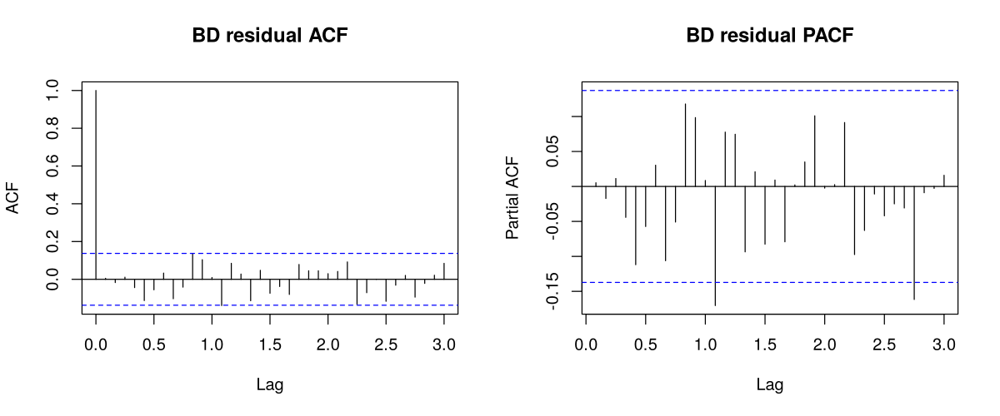
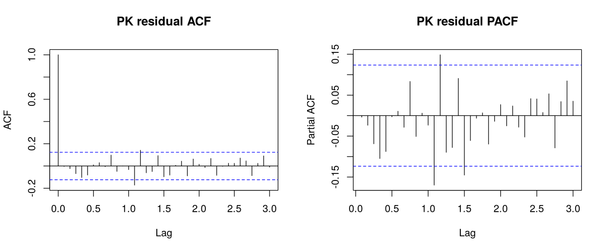

# References

::: {custom-style="Reference"}
Akter, J. (2022). The impact of COVID-19 on the remittance inflows in Bangladesh: An ARDL approach. *International Journal of Asian Social Science, 12*(5), 147–157. https://doi.org/10.55493/5007.v12i5.4486

Aruoba, S. B., & Alper, C. E. (2004). Moving holidays and seasonal adjustment: The case of Turkey. *Review of Middle East Economics and Finance, 2*(3), 203–209. https://doi.org/10.2202/1475-3693.1047

Australian Bureau of Statistics. (2005). Estimating and removing the effects of Chinese New Year and Ramadan to improve the seasonal adjustment process. *Australian Economic Indicators* (Cat. No. 1350.0), Technical Note, November 2005.

Badan Pusat Statistik. (2019). *Seasonal adjustment of Ramadan effect in GDP by expenditures*. BPS-Statistics Indonesia.

Bangladesh Bank. (2026). *Monthly economic trends* (various issues, 2009–2026). Bangladesh Bank. https://www.bb.org.bd

Bell, W. R., & Hillmer, S. C. (1983). Modeling time series with calendar variation. *Journal of the American Statistical Association, 78*(383), 526–534.

Bokhari, S. M. H., & Ansari, I. A. (2009). Seasonal adjustment of some financial indicators of Pakistan. *IBT Journal of Business Studies, 5*(2), 107–123.

Box, G. E. P., & Tiao, G. C. (1975). Intervention analysis with applications to economic and environmental problems. *Journal of the American Statistical Association, 70*(349), 70–79.

Bukhari, S., Jalil, A., & Rao, N. H. (2011). *Detection and forecasting of Islamic calendar effects in time series data: Revisited* (SBP Working Paper No. 39). State Bank of Pakistan.

Chen, C., & Liu, L.-M. (1993). Joint estimation of model parameters and outlier effects in time series. *Journal of the American Statistical Association, 88*(421), 284–297.

Clark, T. E., & West, K. D. (2007). Approximately normal tests for equal predictive accuracy in nested models. *Journal of Econometrics, 138*(1), 291–311.

de Padua, D., Lanzafame, M., Qureshi, I., & Taniguchi, K. (2024). *Understanding the drivers of remittances to Pakistan* (ADB Economics Working Paper No. 733). Asian Development Bank.

Devkota, B. P., & Pokhrel, S. (2023). Forecasting remittance inflow in Nepal using the Box–Jenkins ARIMA model. *Kathford Journal of Engineering and Management, 3*(1), 72–86.

Diebold, F. X. (2015). Comparing predictive accuracy, twenty years later: A personal perspective on the use and abuse of Diebold–Mariano tests. *Journal of Business & Economic Statistics, 33*(1), 1–9.

Diebold, F. X., & Mariano, R. S. (1995). Comparing predictive accuracy. *Journal of Business & Economic Statistics, 13*(3), 253–263.

Eyerci, C., Toprak, A. Ö., & Demir, Ö. (2021). Ramadan effect on prices and production: Case of Turkey. *Statistika: Statistics and Economy Journal, 101*(2), 159–186.

Farabi, M. N. S., Al Mobin, M., & Khan, A. N. (2025). Assessing the efficacy of cash incentive policies in enhancing remittance inflows: Evidence from Bangladesh. *PLOS ONE, 20*(2), e0318342. https://doi.org/10.1371/journal.pone.0318342

Findley, D. F., Monsell, B. C., Bell, W. R., Otto, M. C., & Chen, B.-C. (1998). New capabilities and methods of the X-12-ARIMA seasonal-adjustment program. *Journal of Business & Economic Statistics, 16*(2), 127–152.

Findley, D. F., Wills, K. C., & Monsell, B. C. (2005). *Issues in estimating Easter regressors using RegARIMA models with X-12-ARIMA* [Research report]. U.S. Census Bureau.

Ghimire, B. N. (2026). Machine learning for remittance forecasting and macroeconomic dynamics in Nepal: An integrated analytical framework. *NPRC Journal of Multidisciplinary Research, 3*(2), 164–179. https://doi.org/10.3126/nprcjmr.v3i2.91275

Goswami, G. G., Barai, M. K., Atique, M. A., & Rahman, M. (2023). Did remittance inflow in Bangladesh follow the gravity path during COVID-19? *Economies, 11*(11), 285. https://doi.org/10.3390/economies11110285

Grun Rehomme, M., & Ben Rejeb, A. (2008). Modelling moving feasts determined by the Islamic calendar: Application to macroeconomic Tunisian time series. *Metodološki zvezki, 5*(2), 173–211.

Harvey, D., Leybourne, S., & Newbold, P. (1997). Testing the equality of prediction mean squared errors. *International Journal of Forecasting, 13*(2), 281–291.

Holm, S. (1979). A simple sequentially rejective multiple test procedure. *Scandinavian Journal of Statistics, 6*(2), 65–70.

Hyndman, R. J., & Khandakar, Y. (2008). Automatic time series forecasting: The forecast package for R. *Journal of Statistical Software, 27*(3), 1–22.

Hyndman, R. J., & Koehler, A. B. (2006). Another look at measures of forecast accuracy. *International Journal of Forecasting, 22*(4), 679–688.

Islam, T., Mohib, A. A., & Haque, S. Z. (2018). Econometric models for forecasting remittances of Bangladesh. *Business and Management Studies, 4*(1), 1–9.

Khan, I., & Gunwant, D. F. (2024). Application of ARIMA model in forecasting remittance inflows: Evidence from Yemen. *International Journal of Economic Policy Studies, 18*(1), 283–303. https://doi.org/10.1007/s42495-023-00128-6

Khan, M. M., Khatun, R., Ahmed, A., & Das, S. R. (2022). Macroeconomic determinants of remittance for Bangladesh: A gravity model approach. *International Journal of Research and Innovation in Social Science, 6*(11), 140–147.

Kpodar, K., Mlachila, M., Quayyum, S., & Gammadigbe, V. (2023). Defying the odds: Remittances during the COVID-19 pandemic. *The Journal of Development Studies, 59*(5), 673–690. https://doi.org/10.1080/00220388.2022.2154150

Lin, J.-L., & Liu, T.-S. (2002). *Modeling lunar calendar holiday effects in Taiwan* [Working paper]. U.S. Census Bureau.

Lucas, R. E. B., & Stark, O. (1985). Motivations to remit: Evidence from Botswana. *Journal of Political Economy, 93*(5), 901–918. https://doi.org/10.1086/261341

Omer, M. (2025). Evaluating the impact of withdrawal of telegraphic transfer (TT) charges reimbursement on the remittances from the Kingdom of Saudi Arabia (KSA). *The Lahore Journal of Economics, 30*(2), 37–62. https://doi.org/10.35536/lje.2025.v30.i2.a2

Paternoster, R., Brame, R., Mazerolle, P., & Piquero, A. (1998). Using the correct statistical test for the equality of regression coefficients. *Criminology, 36*(4), 859–866.

Qureshi, J. A. (2016). *The Pakistan Remittance Initiative and remittance flows to Pakistan* (PSSP Working Paper No. 35). International Food Policy Research Institute.

R Core Team. (2024). *R: A language and environment for statistical computing* (Version 4.3.3). R Foundation for Statistical Computing. https://www.R-project.org/

Rapoport, H., & Docquier, F. (2006). The economics of migrants' remittances. In S.-C. Kolm & J. Mercier Ythier (Eds.), *Handbook of the economics of giving, altruism and reciprocity* (Vol. 2, pp. 1135–1198). Elsevier.

Ratha, D., De, S., Kim, E. J., Plaza, S., Seshan, G., & Yameogo, N. D. (2020). *Phase II: COVID-19 crisis through a migration lens* (Migration and Development Brief No. 33). KNOMAD–World Bank.

Riazuddin, R. (2012). *Construction and seasonal patterns of Islamic Hijri calendar monthly time series: An application to CPI in Pakistan* (SBP Working Paper No. 50). State Bank of Pakistan.

Riazuddin, R., & Khan, M. H. (2005). Detection and forecasting of Islamic calendar effects in time series data. *SBP Research Bulletin, 1*(1), 25–34.

Saha, A., & Khanam, M. (2022). Forecasting the growth rate of GDP and its indicators remittance and labor force participation of Bangladesh using VECM and ARIMA models. *Dhaka University Journal of Science, 70*(2), 42–47.

Saleh, S., Wardani, D. T. K., & Ivantri, M. A. (2019). Ramadhan, Eid ul Fitr, and inflation: Lesson from Indonesian subnational data. *Jurnal Ekonomi & Studi Pembangunan, 20*(2), 135–150.

Stark, O., & Lucas, R. E. B. (1988). Migration, remittances, and the family. *Economic Development and Cultural Change, 36*(3), 465–481. https://doi.org/10.1086/451670

State Bank of Pakistan. (2024). External sector. In *Annual report FY24: The state of Pakistan's economy* (Chapter 6). State Bank of Pakistan.

State Bank of Pakistan. (2026). *Workers' remittances* [Data set and monthly releases]. State Bank of Pakistan. https://www.sbp.org.pk

Tashman, L. J. (2000). Out-of-sample tests of forecasting accuracy: An analysis and review. *International Journal of Forecasting, 16*(4), 437–450.

Tasnim, N., & Khanam, M. (2026). A comparison of the VAR model, ARIMA model and Holt's exponential smoothing approach in forecasting remittance and GDP for Bangladesh. *Dhaka University Journal of Science, 74*(2), 243–256. https://doi.org/10.3329/dujs.v74i2.84254

World Bank. (2026). *Personal remittances, received (% of GDP)* [Data set]. World Development Indicators. https://data.worldbank.org/indicator/BX.TRF.PWKR.DT.GD.ZS
:::

# Appendices

## Appendix A: Data Dictionary

Table: Table A.1: Data dictionary

| File | Variable | Description |
|:---|:---|:---|
| bd_remittances_monthly.csv | calendar_date | First day of the month |
| | remittances_usd_mn | Workers' remittances, US\$ million, from Bangladesh Bank *Monthly Economic Trends* |
| | source_issue, source_sheet | Issue and table from which the value was taken (latest issue printing the month) |
| pk_remittances_monthly.csv | date | First day of the month |
| | remittances_usd_mn | Workers' remittances, US\$ million, State Bank of Pakistan |
| | source | SBP release file, bulletin or press figure |
| eid_dates.csv | country, event, eid_date | National Eid al-Fitr and Eid al-Adha dates |
| | status, source | Sourced from a national announcement, or Umm al-Qura fallback |
| eid_exposure_monthly.csv | fitr_w30, adha_w30 | Share of the 30-day pre-Eid window in the month (main regressors) |
| | fitr_w21, adha_w21, fitr_w45, adha_w45 | Regressors for the 21-day and 45-day sensitivity windows |

Table: Table A.2: Fiscal-year totals of workers' remittances (US\$ million; fiscal year ending June)

| Fiscal year | Bangladesh | Pakistan |
|:---|---:|---:|
| 2005-06 | n/a | 4,600 |
| 2006-07 | n/a | 5,494 |
| 2007-08 | n/a | 6,452 |
| 2008-09 | n/a | 7,811 |
| 2009-10 | 10,987 | 8,907 |
| 2010-11 | 11,650 | 11,201 |
| 2011-12 | 12,843 | 13,186 |
| 2012-13 | 14,461 | 13,922 |
| 2013-14 | 14,228 | 15,837 |
| 2014-15 | 15,317 | 18,721 |
| 2015-16 | 14,931 | 19,914 |
| 2016-17 | 12,769 | 19,349 |
| 2017-18 | 14,982 | 19,914 |
| 2018-19 | 16,420 | 21,740 |
| 2019-20 | 18,205 | 23,131 |
| 2020-21 | 24,778 | 29,450 |
| 2021-22 | 21,032 | 31,279 |
| 2022-23 | 21,611 | 27,333 |
| 2023-24 | 23,912 | 30,251 |
| 2024-25 | 30,329 | 38,299 |
| 2025-26 | 35,594 | 41,582 |

## Appendix B: Eid Dates

Table: Table B.1: National Eid dates used (in-sample; * = Umm al-Qura fallback date)

| Hijri year | BD Eid al-Fitr | BD Eid al-Adha | PK Eid al-Fitr | PK Eid al-Adha |
|:---|:---|:---|:---|:---|
| 1426 | 2005-11-03* | 2006-01-11 | 2005-11-03* | 2006-01-10* |
| 1427 | 2006-10-25 | 2007-01-01 | 2006-10-25 | 2006-12-31* |
| 1428 | 2007-10-14 | 2007-12-20* | 2007-10-13* | 2007-12-20* |
| 1429 | 2008-10-02 | 2008-12-08* | 2008-10-01* | 2008-12-08* |
| 1430 | 2009-09-20* | 2009-11-28 | 2009-09-20* | 2009-11-28 |
| 1431 | 2010-09-11 | 2010-11-17 | 2010-09-11 | 2010-11-17 |
| 1432 | 2011-08-31 | 2011-11-07 | 2011-08-31 | 2011-11-06* |
| 1433 | 2012-08-20 | 2012-10-26* | 2012-08-20 | 2012-10-27 |
| 1434 | 2013-08-09 | 2013-10-16 | 2013-08-08* | 2013-10-16 |
| 1435 | 2014-07-29 | 2014-10-06 | 2014-07-29 | 2014-10-06 |
| 1436 | 2015-07-18 | 2015-09-25 | 2015-07-18 | 2015-09-25 |
| 1437 | 2016-07-07 | 2016-09-13 | 2016-07-06 | 2016-09-13 |
| 1438 | 2017-06-26 | 2017-09-02 | 2017-06-26 | 2017-09-02 |
| 1439 | 2018-06-16 | 2018-08-22 | 2018-06-16 | 2018-08-22 |
| 1440 | 2019-06-05 | 2019-08-12 | 2019-06-05 | 2019-08-12 |
| 1441 | 2020-05-25 | 2020-08-01 | 2020-05-24 | 2020-08-01 |
| 1442 | 2021-05-14 | 2021-07-21 | 2021-05-13 | 2021-07-21 |
| 1443 | 2022-05-03 | 2022-07-10 | 2022-05-03 | 2022-07-10 |
| 1444 | 2023-04-22 | 2023-06-29 | 2023-04-22 | 2023-06-29 |
| 1445 | 2024-04-11 | 2024-06-17 | 2024-04-10 | 2024-06-17 |
| 1446 | 2025-03-31 | 2025-06-07 | 2025-03-31 | 2025-06-07 |
| 1447 | 2026-03-21 | 2026-05-28 | 2026-03-21 | 2026-05-27 |

## Appendix C: Forecast Comparison by Horizon

Table: Table C.1: Forecast comparison by horizon (main specification)

| Country | h | n | Clark–West t | Clark–West p (one-sided) | Diebold–Mariano p | RMSE improvement (%) |
|:---|---:|---:|---:|---:|---:|---:|
| Bangladesh | 1 | 108 | 3.30 | 0.0005 | 0.014 | 9.8 |
| Bangladesh | 2 | 107 | 2.21 | 0.0135 | 0.023 | 2.8 |
| Bangladesh | 3 | 106 | 2.09 | 0.0184 | 0.035 | 2.1 |
| Bangladesh | 4 | 105 | 1.56 | 0.0595 | 0.171 | 0.7 |
| Bangladesh | 5 | 104 | 1.42 | 0.0775 | 0.322 | 0.3 |
| Bangladesh | 6 | 103 | 1.18 | 0.1198 | 0.702 | -0.4 |
| Bangladesh | 7 | 102 | 1.45 | 0.0740 | 0.759 | -0.0 |
| Bangladesh | 8 | 101 | 1.15 | 0.1256 | 0.657 | -0.4 |
| Bangladesh | 9 | 100 | 0.46 | 0.3227 | 0.976 | -1.9 |
| Bangladesh | 10 | 99 | 0.31 | 0.3785 | 0.854 | -2.3 |
| Bangladesh | 11 | 98 | 0.30 | 0.3836 | 0.953 | -1.3 |
| Bangladesh | 12 | 97 | 0.19 | 0.4239 | 0.592 | -1.4 |
| Pakistan | 1 | 108 | 3.66 | 0.0001 | 0.007 | 11.6 |
| Pakistan | 2 | 107 | 3.24 | 0.0006 | 0.100 | 8.3 |
| Pakistan | 3 | 106 | 3.66 | 0.0001 | 0.040 | 9.2 |
| Pakistan | 4 | 105 | 3.15 | 0.0008 | 0.021 | 7.4 |
| Pakistan | 5 | 104 | 3.22 | 0.0006 | 0.067 | 6.9 |
| Pakistan | 6 | 103 | 3.50 | 0.0002 | 0.112 | 7.0 |
| Pakistan | 7 | 102 | 3.29 | 0.0005 | 0.022 | 5.3 |
| Pakistan | 8 | 101 | 4.30 | 0.0000 | 0.001 | 5.2 |
| Pakistan | 9 | 100 | 3.93 | 0.0000 | 0.042 | 3.4 |
| Pakistan | 10 | 99 | 3.25 | 0.0006 | 0.144 | 2.4 |
| Pakistan | 11 | 98 | 2.64 | 0.0041 | 0.110 | 2.5 |
| Pakistan | 12 | 97 | 2.58 | 0.0050 | 0.067 | 2.3 |

## Appendix D: Residual Diagnostics and Robustness of Inference

Table: Table D.1: Standard errors of the Eid coefficients under alternative methods (main specification)

| Method | BD Fitr | BD Adha | PK Fitr | PK Adha |
|:---|---:|---:|---:|---:|
| Model-based (maximum likelihood) | 0.031 | 0.031 | 0.023 | 0.023 |
| HAC, Andrews quadratic spectral (used in text) | 0.028 | 0.030 | 0.027 | 0.025 |
| HAC, Newey–West, prewhitened | 0.029 | 0.026 | 0.028 | 0.025 |
| Moving-block bootstrap (block length 24, 999 replications) | 0.034 | 0.032 | 0.022 | 0.023 |

Table: Table D.2: Alternative error specifications for Pakistan

| Error specification | AICc | Ljung–Box(24) p | β Fitr | β Adha |
|:---|---:|---:|---:|---:|
| Selected: (3,1,1)(1,0,0) + drift | −537.9 | 0.014 | 0.179 | 0.139 |
| (0,1,1)(1,0,1) + drift | −533.7 | <0.001 | 0.152 | 0.144 |
| (0,1,1)(2,0,0) + drift | −528.8 | <0.001 | 0.167 | 0.154 |
| (2,1,2)(1,0,1) + drift | −537.3 | 0.002 | 0.175 | 0.142 |
| MA terms at lags 1, 13, 14 | −537.4 | 0.033 | 0.173 | 0.134 |
| Airline (0,1,1)(0,1,1) | −497.0 | <0.001 | 0.147 | 0.140 |

Note: AICc values are for each specification fitted with its own selected interventions and are not comparable with Table 4.3.

{width=5.5in}

{width=5.5in}

## Appendix E: Code and Reproducibility

All code and data are available at github.com/sharofsh/bd-pk-eid-remittances. The analysis is run in the following order.

Table: Table E.1: Analysis scripts

| Script | Purpose |
|:---|:---|
| 00_build_eid_dates.py | Compile national Eid dates with sources and Umm al-Qura fallbacks |
| 01_eid_exposure.R | Build the monthly Eid regressors for each window length |
| 02_identify_sarima_benchmark.R | Identify the Box–Jenkins benchmark from ACF/PACF on data to June 2017 |
| 03_rq1_estimation.R | Full-sample estimation, cross-country test, diagnostics, window comparison |
| 04_forecast_run.R | Rolling-origin forecasts for all models and specifications |
| 05_evaluate.R | Accuracy measures, Clark–West and Diebold–Mariano tests, Holm correction |
| 07_pk_inference.R | HAC and bootstrap standard errors; alternative error specifications |
| lib_model.R, lib_outliers.R | Model fitting and Chen–Liu intervention detection |
| 10_window_training.R | Window-length choice on data up to June 2017 |
| run_analysis.R | Runner (set WINDOW = "30" for the main results) |
