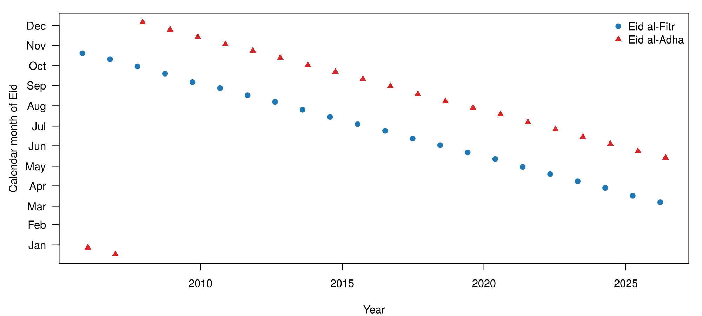
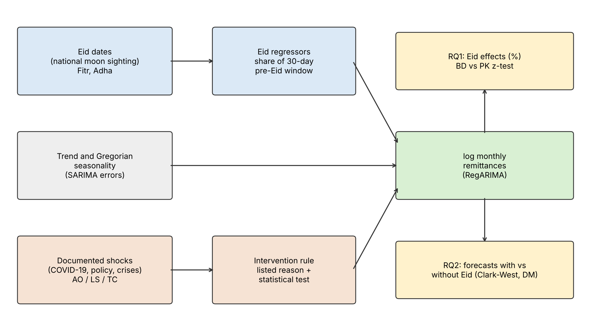
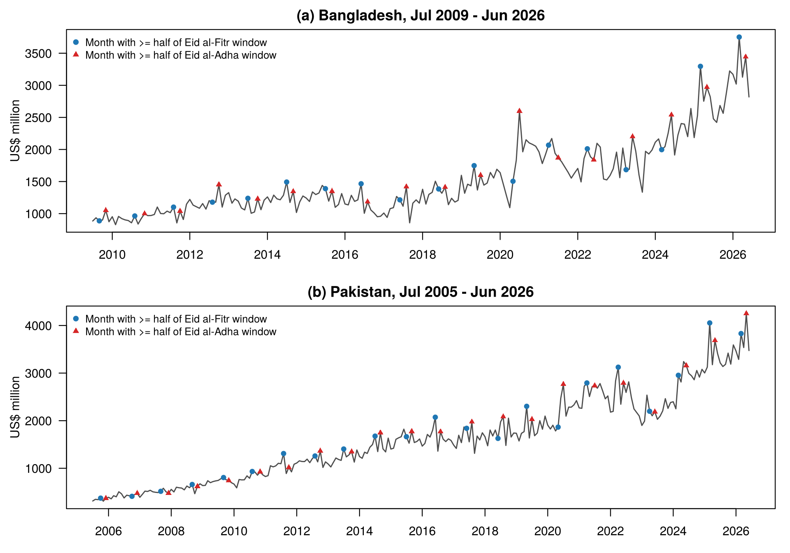
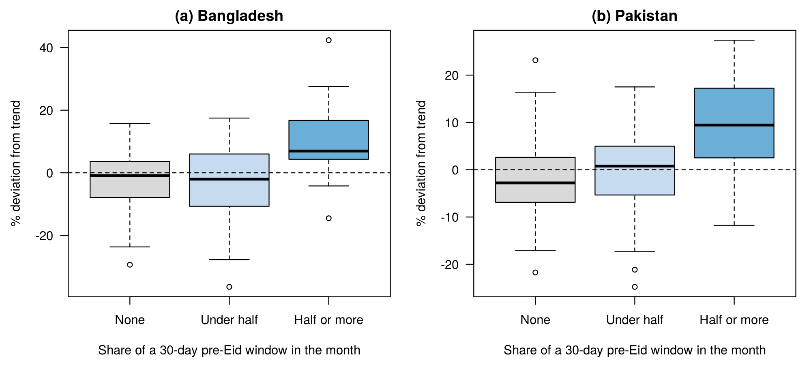
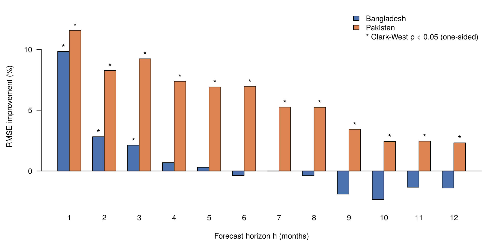

# Chapter 1`<w:r><w:br/></w:r>`{=openxml}Introduction

## 1.1 Background

Workers' remittances are one of the largest sources of foreign exchange for Bangladesh and Pakistan. In fiscal year 2024–25, Bangladesh received US\$30.3 billion and Pakistan US\$38.3 billion through formal channels (Bangladesh Bank, 2026; State Bank of Pakistan, 2026). In 2024, personal remittances were 6.1% of GDP in Bangladesh and 9.4% in Pakistan (World Bank, 2026). Remittances finance a large share of import payments and support foreign-exchange reserves (State Bank of Pakistan, 2024). Central banks and finance ministries need reliable short-term forecasts of monthly inflows.

The amount of money migrants send home each month is not constant through the year. It increases in the weeks before the two main Muslim festivals, Eid al-Fitr and Eid al-Adha. In Pakistan, Islamic-holiday effects have been estimated in seasonal models of workers' remittances (Bokhari & Ansari, 2009). Official data show the same pattern in recent years. Bangladesh's highest monthly inflow on record, US\$3.30 billion in March 2025, came in the month of Eid al-Fitr (Bangladesh Bank, 2026). In Pakistan, inflows rose by 31% from February to March 2024, the month before Eid al-Fitr (State Bank of Pakistan, 2026).

The timing of this increase is what makes it hard to forecast. The two Eids follow the lunar Hijri calendar, whose year is about 11 days shorter than the Gregorian year (Riazuddin, 2012; Grun Rehomme & Ben Rejeb, 2008). Each Eid falls about 11 days earlier every year and moves through every Gregorian month over roughly 33 years. So the extra transfers arrive in a different calendar month from year to year. Most forecasting models, including seasonal ARIMA models, treat seasonality as a fixed pattern by Gregorian month. They cannot follow a festival that moves in this way, and this is the problem the study addresses.

## 1.2 Problem Statement and Motivation

Moving holidays are a known problem in economic time series. Statistical agencies model holidays such as Easter by adding calendar regressors to a regression model with ARIMA errors, known as RegARIMA (Bell & Hillmer, 1983; Findley et al., 1998). Similar methods have been applied to Islamic holidays in Tunisia, Turkey and Pakistan (Grun Rehomme & Ben Rejeb, 2008; Aruoba & Alper, 2004; Riazuddin & Khan, 2005). For remittances, three gaps remain. No study has yet estimated the effect of Eid on Bangladesh's monthly remittances. No study has tested whether accounting for Eid makes remittance forecasts more accurate. No study has compared the Eid effect between Bangladesh and Pakistan.

This study addresses these gaps. It estimates separate Eid al-Fitr and Eid al-Adha effects for both countries with RegARIMA models, tests whether the effects differ between them, and compares forecasts made with and without Eid regressors.

The rationale is practical as well as academic. If the Eid effect is ignored, forecasts are too low in Eid months and too high in the months the festival has left. Errors of this kind affect reserve planning, and a rise caused only by Eid can be mistaken for a change in trend. Because Eid dates are known years in advance, the effect can be built into forecasts at almost no cost, if its size is known. Pakistan is included as a comparison for four reasons. First, it depends on remittances to a similar or greater degree: personal remittances were 9.4% of GDP in Pakistan and 6.1% in Bangladesh in 2024 (World Bank, 2026). Second, both countries celebrate the same two Eids on nationally announced dates, so the same method can be applied to both without change. Third, to our knowledge, Pakistan is the only country in which Islamic-holiday effects on remittances have been estimated before, by Bokhari and Ansari (2009). Those estimates provide a benchmark against which the method can be checked, which is not possible for Bangladesh. Fourth, both countries have introduced policies to move remittances into formal channels, Bangladesh through a cash incentive in 2019 and Pakistan through the Pakistan Remittance Initiative in 2009 (Farabi et al., 2025; Qureshi, 2016). Similar policy shocks can therefore be treated with the same intervention framework.

## 1.3 Research Questions and Objectives

The study will address the following research questions.

**RQ1 (effect estimation).**

- Are Eid al-Fitr and Eid al-Adha associated with changes in monthly workers' remittances in Bangladesh and Pakistan?

- Do the size and direction of these effects differ between the two countries?

**RQ2 (forecasting value).**

- Do Eid regressors improve out-of-sample forecasts of monthly workers' remittances in each country?

**Objectives.** The objectives of this study are to:

- construct monthly Eid regressors for each country from its own national Eid dates;

- estimate the effects of Eid al-Fitr and Eid al-Adha on log remittances with a regression model with SARIMA errors (RegARIMA);

- test whether the Eid effects differ between Bangladesh and Pakistan;

- assess whether including Eid regressors improves the accuracy of remittance forecasts from 1 to 12 months ahead; and

- assess how forecasts that account for Eid perform against commonly used forecasting methods.

## 1.4 Hypotheses

The study tests the following null hypotheses.

- **H₀₁:** Eid al-Fitr and Eid al-Adha have no effect on monthly workers' remittances in Bangladesh or Pakistan.

- **H₀₂:** The Eid effects on remittances are the same in Bangladesh and Pakistan.

- **H₀₃:** Including Eid regressors does not improve the accuracy of remittance forecasts.

The alternative hypotheses are that Eid is associated with a change in remittances (H₁₁), that the effects differ between the two countries (H₁₂), and that Eid regressors improve forecast accuracy (H₁₃). Chapter 3 gives the statistical form of each test.

## 1.5 Significance of the Study

The study is significant for research and for practice in both countries.

For research, it is one of the first studies to measure how much Eid al-Fitr and Eid al-Adha raise monthly remittances to Bangladesh and Pakistan, and to compare the two countries. It also applies formal forecast-comparison tests to remittance forecasting. Earlier remittance forecasting studies for Bangladesh compared models only by how well they fitted past data, so they could not show whether a new model forecasts better.

For practice, the results are useful to Bangladesh Bank and the State Bank of Pakistan. Both banks plan foreign-exchange reserves and exchange-rate policy partly on expected remittance inflows. A forecast that does not allow for Eid will under-predict the months before the festival and over-predict the months after it. A model with Eid regressors corrects this. Because Eid dates are known years ahead, the correction can be added to an existing ARIMA forecasting model without new data. The estimated effect sizes also help analysts read monthly figures correctly. A sharp rise in an Eid month, or a fall in the month after, can then be separated from a genuine change in the trend of remittances.

## 1.6 Organization of the Thesis

The thesis has five chapters. Chapter 2 reviews the literature and Chapter 3 describes the data and methods. Chapter 4 presents and discusses the results, and Chapter 5 concludes. The appendices contain supporting tables, diagnostics and the code.

# Chapter 2`<w:r><w:br/></w:r>`{=openxml}Literature Review

## 2.1 Introduction

This chapter reviews research on remittances in Bangladesh and Pakistan, on why remittances rise before festivals, and on Islamic-calendar effects. It then reviews the methods used to model and forecast such series and ends with the research gap (Section 2.6).

## 2.2 Remittances in Bangladesh and Pakistan

Remittances are a major source of foreign exchange for both countries and support their balance of payments (State Bank of Pakistan, 2024; World Bank, 2026). In 2024, personal remittances were 6.1% of GDP in Bangladesh, below a peak of 10.6% in 2012, and 9.4% in Pakistan (World Bank, 2026). Recorded figures understate the true flow. Part of the money is sent through hundi, an informal and illegal channel that official statistics do not capture (Farabi et al., 2025). Recent studies of the determinants of recorded inflows to Bangladesh find that income at home raises remittances and transaction costs reduce them (Khan et al., 2022), and that the exchange rate has a positive long-run effect on them (Akter, 2022). Using annual data for 1976–2021, Faruq (2025) finds that the number of unskilled migrants, domestic GDP, the oil price and the exchange rate all affect inflows significantly.

Because part of the flow can switch between informal and formal channels, the recorded series also responds to policy. The literature identifies three kinds of policy-related event that have shifted recorded remittances in the two countries.

- **Incentives for formal channels.** Bangladesh introduced a 2% cash incentive on remittances received through formal channels in July 2019. Using interrupted time-series analysis, Farabi et al. (2025) estimate that the incentive caused an immediate, sustained 6.68% rise in inflows, with a further 0.25% each month. Pakistan launched the Pakistan Remittance Initiative in 2009. Qureshi (2016) finds that it moved remittances from informal to formal channels, but that it is unclear whether it raised the total amount received. Withdrawing an incentive has the opposite effect: after Pakistan stopped reimbursing transfer charges on remittances from Saudi Arabia in May 2020, monthly remittances from that country fell by an estimated US$31–76 million (Omer, 2025).

- **COVID-19.** Recorded remittances fell in early 2020, then rose. Using monthly data for 52 countries, Kpodar et al. (2023) find that a shift from informal to formal channels, caused by travel restrictions, contributed to the surge in formal remittances. For Bangladesh, Akter (2022) finds a positive long-run effect of the pandemic in monthly data for 2008–2021. The World Bank reached the same conclusion for South Asia and warned that incentives in Bangladesh and Pakistan could make part of the increase more apparent than real (Ratha et al., 2020).

- **Exchange-market reforms.** The State Bank of Pakistan credits reforms of exchange companies, under the 2023–24 IMF Stand-By Arrangement, with improving Pakistan's external position in FY24 (State Bank of Pakistan, 2024). In Bangladesh, recorded inflows rose sharply after the change of government in August 2024 (Bangladesh Bank, 2026); we found no published study of the cause.

These studies show that policy and channel shifts move the level of the recorded series. A model that ignores them can mistake a policy shift for a festival effect, or forecast from the wrong level.

## 2.3 Theoretical Background: Why Remittances Rise Before Festivals

Policy explains shifts in the level of remittances, but not their timing within the year. The migration literature explains remittances mainly as support for the family at home (Lucas & Stark, 1985; Rapoport & Docquier, 2006). If migrants remit to meet their families' needs, transfers should rise when those needs peak. Lucas and Stark (1985) set out three motives: altruism towards the family; self-interest, for example protecting an inheritance or assets at home; and an implicit contract in which migrant and family insure each other. Stark and Lucas (1988) describe remittances as part of a longer-term family arrangement covering education, migration costs and support in bad times.

Household spending in Muslim-majority countries rises sharply around Ramadan and the two Eids. In Pakistan, currency in circulation rises and bank deposits fall before these festivals, reflecting higher cash spending (Riazuddin & Khan, 2005; Bukhari et al., 2011). Under the altruism and family-contract motives, migrants should send more money in the weeks before each Eid. Bokhari and Ansari (2009) found a Dul-Haj effect in Pakistan's workers' remittances (Section 2.4), which is consistent with this view.

The timing of the festivals matters for modelling. Holidays on fixed Gregorian dates, such as Christmas, fall in the same month every year, so ordinary monthly seasonal terms absorb their effect (Bell & Hillmer, 1983). The Eids move about 11 days earlier each Gregorian year, so the extra transfers fall in a different month over time. Fixed monthly seasonality cannot capture them (Grun Rehomme & Ben Rejeb, 2008). This is the motivation for modelling Eid explicitly.

## 2.4 Related Empirical Studies: Islamic-Calendar Effects in Economic Time Series

If festivals drive remittances, the effect should appear in monthly data, as it does in other economic series. Studies across Muslim-majority economies agree that Islamic holidays shift economic activity between calendar months and that ignoring this distorts seasonal adjustment and forecasts. They differ in the series studied and in how they define the holiday period.

The most relevant evidence comes from the State Bank of Pakistan. Riazuddin and Khan (2005) added fractional Islamic-calendar indicators to ARIMA models of Pakistan's currency in circulation. They found strong Ramadan and Eid effects and showed that conventional seasonal adjustment gives distorted results in Islamic countries. Bukhari et al. (2011) extended this work to deposits and consumer prices. They found that Ramadan and Zilhaj raise currency holdings, lower deposits and coincide with higher prices, and that monthly forecasts are biased when these effects are ignored. These studies show that Islamic holidays matter for Pakistan's monetary data, but they do not examine remittances.

Recent studies from other Muslim-majority countries find the same pattern in prices and production. Eyerci et al. (2021) rebuilt Turkish monthly consumer price and industrial production indicators on the Hijri calendar and found that food prices rose, and industrial production fell, significantly more in Ramadan than in other months. They argue that accounting for Ramadan would improve inflation forecasts and seasonal adjustment. Saleh et al. (2019) found, for 66 Indonesian local economies over 2000–2017, that Ramadan and Eid al-Fitr raise inflation.

Studies outside South Asia mainly concern the choice of holiday window. Grun Rehomme and Ben Rejeb (2008) modelled Ramadan and both Eids in Tunisian imports, employment, energy and money supply, using separate windows before, during and after each feast. They chose the window lengths by AICc and forecast error, and the best Eid al-Fitr window ranged from 7 to 41 days across series. The Australian Bureau of Statistics (2005) used windows of 6 days before and 6 days after Ramadan and Eid for visitor arrivals from Indonesia. Lin and Liu (2002) used windows before, around and after Chinese New Year in Taiwan. Aruoba and Alper (2004) showed that Turkish series adjusted by standard methods still contain Hijri-holiday effects. Together, these studies show that the window length should be chosen from the data, which is the approach taken in this study.

Only one study has applied holiday terms to remittances. Bokhari and Ansari (2009) seasonally adjusted five Pakistani financial series, including workers' remittances, with X-12-ARIMA and Ramadan and Dul-Haj regressors. They found a Dul-Haj effect of about 13.8%. Their aim was seasonal adjustment, not forecasting. They did not test whether the holiday terms improve out-of-sample forecasts, did not model Eid al-Fitr separately, and did not cover Bangladesh. These are the gaps this study fills.

## 2.5 Statistical Methods Applied in Similar Contexts

### 2.5.1 Moving-holiday regressors

The standard way to model a holiday that changes date is a regression on the share of a pre-holiday window that falls in each month, with ARIMA errors. Bell and Hillmer (1983) assume that activity shifts by a constant amount on each of the w days before a holiday, so the monthly regressor is the proportion of that window falling in the month. The US Census Bureau's X-12-ARIMA, now X-13ARIMA-SEATS, uses this construction for Easter within the RegARIMA model (Findley et al., 1998).

Three points from this literature shape the present study. First, the regressor has been extended to lunar holidays. Lin and Liu (2002) show for Chinese New Year in Taiwan that holiday regressors control the effect of the moving holiday and improve the seasonal decomposition, and Grun Rehomme and Ben Rejeb (2008) apply it to Islamic feasts in Tunisia. Suhartono et al. (2017) include Eid calendar-variation terms in ARIMAX and hybrid neural-network models of monthly currency inflows and outflows at Bank Indonesia. They compare model types on a single 12-month hold-out rather than models with and without the Eid terms. Hendikawati et al. (2022) make that comparison for monthly passenger numbers at Jakarta's Tanjung Priok port. Over a hold-out period from January 2017 to November 2019, adding an Eid al-Fitr term lowered RMSE and MAPE, and a dummy variable did better than a days-proportion regressor. Their comparison rests on one hold-out period, with no test of significance. Second, X-12-ARIMA chooses the Easter window by comparing models with w = 1, 8 and 15 days, and with no Easter term, by AICc (Findley et al., 2005). Lin and Liu and Grun Rehomme and Ben Rejeb also choose window lengths by AICc together with out-of-sample forecast errors. The chosen lengths vary widely by series; in Tunisia, Eid al-Fitr windows range from 7 to 41 days. Findley et al. (2005) warn that AICc-based choice can be sensitive to outliers and sample length. Third, several applications to lunar holidays add during- or after-holiday terms to the pre-holiday window (Australian Bureau of Statistics, 2005; Grun Rehomme & Ben Rejeb, 2008).

### 2.5.2 Interventions and order selection

The policy events reviewed in Section 2.2 call for a second set of regressors. One-off events are handled with intervention variables, introduced by Box and Tiao (1975) for known events in time series. Chen and Liu (1993) set out the standard types: an additive outlier affecting one month, a level shift, and a temporary change that decays. They also gave a procedure for detecting them, implemented in the R package tsoutliers. ARIMA orders are commonly selected automatically with the Hyndman and Khandakar (2008) algorithm in the R package forecast.

### 2.5.3 Remittance forecasting studies

Studies that forecast remittances to Bangladesh use ARIMA-type or VAR models with either annual data (Saha & Khanam, 2022; Tasnim & Khanam, 2026) or monthly data with seasonal terms tied to the Gregorian calendar (Islam et al., 2018; Faruq, 2025), and none includes an Eid term (Table 2.1). Neither design can capture a moving festival. Annual totals hide any within-year pattern, and Gregorian seasonal terms give the same effect to the same calendar month every year, whereas Eid moves about 11 days earlier each year (Section 2.3). The Bangladesh studies also choose between models by comparing error measures such as RMSE, MAE and MAPE. For example, Tasnim and Khanam (2026) find that VAR gives the lowest errors for annual data for 1990–2022, and Faruq (2025) forecasts monthly remittances with an ARIMA(12,1,11) model. Neither tests whether one model's forecasts are significantly more accurate than another's. Studies elsewhere show the same limitation on festival effects. Khan and Gunwant (2024) fit ARIMA to annual remittances to Yemen, and Devkota and Pokhrel (2023) do the same for Nepal. Ghimire (2026) uses monthly data for Nepal, rolling-origin evaluation and Diebold–Mariano tests, and finds that machine-learning models beat ARIMA. He attributes a late-2023 surge partly to pre-festival transfers but includes no festival term. Work on Pakistan has instead focused on the macroeconomic drivers of remittances, which de Padua et al. (2024) find change over time.

Table: Table 2.1: Remittance forecasting studies reviewed

| Study | Country | Data | Models | Holiday terms |
|:---|:---|:---|:---|:---|
| Saha and Khanam (2022) | Bangladesh | Annual, 1999–2020 | VECM, ARIMA | None |
| Islam et al. (2018) | Bangladesh | Bangladesh Bank, 1998–2003 | SARIMA, GARCH | Not reported |
| Faruq (2025) | Bangladesh | Monthly | ARIMA(12,1,11) | None |
| Tasnim and Khanam (2026) | Bangladesh | Annual, 1990–2022 | VAR, ARIMA, Holt | None |
| de Padua et al. (2024) | Pakistan | Monthly bilateral, 2003–2021 | Bayesian VAR (drivers, not forecast evaluation) | None |
| Devkota and Pokhrel (2023) | Nepal | Annual, 1990/91–2021/22 | ARIMA | None |
| Ghimire (2026) | Nepal | Monthly, 2000–2023 | ARIMA, VAR, random forest, XGBoost, LSTM | None |
| Khan and Gunwant (2024) | Yemen | Annual, 2000–2019 | ARIMA | None |

### 2.5.4 Forecast evaluation

Testing whether one forecast is significantly more accurate than another requires an evaluation design. The forecasting literature recommends judging a model by its out-of-sample forecasts, simulated with a rolling origin, and testing differences in accuracy formally. Tashman (2000) recommends rolling-origin designs, in which the model is re-estimated at each forecast origin using only the data available at that point. This gives many forecasts per horizon instead of a single hold-out test. Hyndman and Koehler (2006) review accuracy measures such as RMSE, MAPE and the mean absolute scaled error.

Diebold and Mariano (1995) test whether two forecasts have equal expected loss, and Harvey et al. (1997) correct the test for small samples and multi-step horizons. Diebold (2015) cautions that the test was designed to compare forecasts, not models, and that it is not suited to nested models. This matters here because the baseline is nested within the model with Eid regressors. With nested models the Diebold–Mariano test is undersized: estimating the extra parameters adds noise that favours the smaller model, even when the larger one is correct. Clark and West (2007) adjust the loss difference for this noise; in their simulations the adjusted test has close to correct size. When several horizons or countries are tested, Holm's (1979) step-down procedure controls the chance of at least one false rejection and is less conservative than the Bonferroni correction.

## 2.6 Identified Research Gaps

Studies of Islamic-calendar effects show that lunar holidays shift monthly economic activity and can be modelled with Bell–Hillmer regressors in RegARIMA models, and forecast-evaluation research provides tests suited to nested models. No study has yet modelled the Eid effect on Bangladesh's remittances. Goswami et al. (2023), using monthly inflows from 12 source countries, note that remittances are higher in Ramadan and Eid months but their gravity models control only for Gregorian calendar months, which cannot follow a moving holiday. Bangladesh forecasting studies use annual data or Gregorian seasonality. The only study found that applies Islamic-holiday terms to remittances, Bokhari and Ansari (2009) for Pakistan, aimed at seasonal adjustment rather than forecasting. To our knowledge, no study has estimated separate Eid al-Fitr and Eid al-Adha effects on Bangladesh's monthly remittances, tested formally whether Eid regressors improve out-of-sample remittance forecasts, or compared Eid effects between Bangladesh and Pakistan. This study addresses these three gaps, with Bangladesh as the main case and Pakistan as the comparison. Pakistan is a useful comparison because earlier estimates of holiday effects on its remittances (Bokhari & Ansari, 2009) provide a benchmark for the method. Chapter 3 describes the data and methods used to do so.

# Chapter 3`<w:r><w:br/></w:r>`{=openxml}Methods and Materials

## 3.1 Data Source and Description

Monthly data on workers' remittances were collected from the central banks of the two countries. For Bangladesh, the data were compiled from the issues of *Monthly Economic Trends* published on the Bangladesh Bank website. For Pakistan, they were taken from the State Bank of Pakistan's workers' remittances release file and its monthly releases. Both countries are analysed with identical code and evaluated on the same target months. The data are summarised in Table 3.1.

Table: Table 3.1: Data sources

| | Bangladesh | Pakistan |
|:---|:---|:---|
| Source | Bangladesh Bank, *Monthly Economic Trends*, Table XVIII (Table XXI in earlier issues); each month taken from the latest issue that prints it | State Bank of Pakistan, workers' remittances; SBP release file to December 2024, SBP bulletins and press figures from January 2025 |
| Series | US\$ million, not seasonally adjusted | US\$ million, original (not seasonally adjusted) series |
| Span | July 2009 to June 2026 (204 months) | July 2005 to June 2026 (252 months) |
| Transformation | Natural log | Natural log |

Each country's full span is used, and levels are never compared across countries. For Bangladesh, each month's value is taken from the most recent issue that prints it, so revised figures replace first releases, and the issue used is recorded for every month. The August 2024 value equals Bangladesh Bank's first-released figure (US\$2.22 billion), and the FY2023-24 and FY2024-25 totals match the published figures. For Pakistan, values to December 2024 come from SBP's workers' remittances release file. Later months were not yet in that file, so they were collected from SBP monthly releases and from news reports quoting SBP, with the source of each month recorded.

**Eid dates.** Each country's national Eid dates were taken from news reports of the national moon-sighting announcements, with a source recorded for each event. Where no date could be sourced, the Umm al-Qura calendar date was used and flagged; this applied to 2 of 36 in-sample events for Bangladesh and 10 of 44 for Pakistan. National dates matter because Bangladesh and Pakistan often celebrate Eid one day after Saudi Arabia, and a one-day shift moves part of the window between months.

## 3.2 Study Variables

The dependent variable is the natural log of monthly workers' remittances in US\$ million. The independent variables are the two Eid regressors and the intervention regressors (Table 3.2).

Table: Table 3.2: Study variables

| Variable | Type | Definition |
|:---|:---|:---|
| log Y~t~ | Dependent | Natural log of monthly workers' remittances, US\$ million |
| Fitr~t~ | Independent | Share of the 30-day window ending on Eid al-Fitr day that falls in month t (0 to 1) |
| Adha~t~ | Independent | Share of the 30-day window ending on Eid al-Adha day that falls in month t (0 to 1) |
| Z~t~ | Control | Intervention regressors (additive outlier, level shift or temporary change) selected by the rule in Section 3.4.3 |
| ε~t~ | Error | SARIMA process capturing trend, Gregorian seasonality and short-run dependence |

**Eid regressors.** For month t and an Eid on day D, the regressor equals the share of the w-day window ending on Eid day (inclusive) that falls in month t:

$$E^{(w)}_t = \frac{n_t}{w}$$

where n~t~ is the number of the w days from D − w + 1 to D (inclusive) that fall in month t.

A window entirely inside one month gives 1 in that month; a window split across two months is divided between them. For example, if Eid falls on 10 April, the 30-day window runs from 12 March to 10 April. March contains 20 of the 30 days, so March = 20/30 = 0.67; April contains 10 days, so April = 0.33; every other month is 0. The window length w is chosen by model fit (Section 3.4.4); the chosen length, 30 days, is roughly the length of Ramadan. The regressors are the raw window shares, not centred on their long-run monthly means as in X-13ARIMA-SEATS, because the aim here is forecasting and effect estimation rather than seasonal adjustment. Figure 3.1 shows how the Eid dates move through the calendar over the sample.

{width=6in}

## 3.3 Conceptual Framework

Log remittances are explained by three components (Figure 3.2): the Eid regressors, built from national Eid dates; the trend and Gregorian seasonality, captured by the SARIMA errors; and documented one-off shocks, entered as intervention regressors only when they pass the intervention rule. The fitted model answers RQ1 through the Eid coefficients, and RQ2 through a comparison of forecasts from the model with and without the Eid regressors.

{width=6in}

## 3.4 Statistical and Computational Methods

### 3.4.1 The RegARIMA model

The model for each country is a regression with seasonal ARIMA errors:

$$\log Y_t = \beta_0 + \beta_F\, \mathrm{Fitr}_t + \beta_A\, \mathrm{Adha}_t + \gamma' Z_t + \varepsilon_t, \qquad \varepsilon_t \sim \mathrm{SARIMA}(p,d,q)(P,D,Q)_{12}$$

With differenced errors, a drift term replaces the intercept and linear trend; it is considered when d + D = 1 and kept only if it lowers AICc. Two models are compared throughout:

- **Baseline:** Z only, with no Eid regressors.

- **Model with Eid regressors:** Z plus Fitr and Adha, with identical orders, training data and interventions.

**Order selection.** Orders are chosen by auto.arima (Hyndman & Khandakar, 2008) on the baseline, given Z. The search is exhaustive over p, q ≤ 3 and P, Q ≤ 1, with AICc as the criterion. The KPSS test chooses d, and the default seasonal-strength test chooses D. The choice of D is checked with the OCSB and Canova–Hansen seasonal unit-root tests. The same orders are used for the model with Eid regressors, so the two models differ only in the Eid regressors.

**Effects** are reported as percentage changes for a month that contains the full 30-day window, relative to a month containing none of it:

$$\%\Delta = 100\,\big(e^{\beta}-1\big)$$

with 95% confidence intervals from the Hessian-based standard errors.

### 3.4.2 Intervention variables

Three standard intervention types are used (Chen & Liu, 1993). For an event in month τ:

- an **additive outlier (AO)** affects month τ only: AO~t~ = 1 if t = τ, 0 otherwise;

- a **level shift (LS)** is a permanent step: LS~t~ = 1 if t ≥ τ, 0 otherwise;

- a **temporary change (TC)** decays geometrically: TC~t~ = δ^t−τ^ for t ≥ τ, 0 otherwise, with δ = 0.7, so the effect falls by 30% each month.

### 3.4.3 Intervention rule

An intervention enters the model only if (1) it is on a candidate list of events with a dated external reason (Table 3.3), (2) it is detected statistically on the model with Eid regressors, and (3) at least 3 observations after its date lie in the training window. The selected set is used in both models of the pair. Requiring both a documented reason and statistical evidence prevents a dummy being added for every unusual month, while still allowing documented shocks to be modelled.

Table: Table 3.3: Candidate interventions

| ID | Country | Window | External reason |
|:---|:---|:---|:---|
| B1 | Bangladesh | Jul 2019 | 2% cash incentive on formal-channel remittances |
| B2 | Bangladesh | Mar to Jul 2020 | COVID-19: lockdowns, job losses, disruption of informal (hundi) channels |
| B3 | Bangladesh | Jan 2022 | Incentive raised from 2% to 2.5% |
| B4 | Bangladesh | Sep 2022 | Cap on the remittance exchange rate |
| B5 | Bangladesh | Aug to Oct 2024 | Change of government; rise in formal-channel remittances |
| P1 | Pakistan | Oct 2008 to Jan 2009 | Global financial crisis shock to Gulf labour markets |
| P2 | Pakistan | Apr to Jun 2009 | Pakistan Remittance Initiative launched |
| P3 | Pakistan | Jul 2016 | Contraction of the Gulf labour market |
| P4 | Pakistan | Mar to Jul 2020 | COVID-19 |
| P5 | Pakistan | Sep 2022 | Widening interbank–open-market exchange-rate gap |
| P6 | Pakistan | Sep 2023 | Crackdown on currency smuggling and the kerb market |

**Detection.** The model with Eid regressors is fitted with airline errors, SARIMA(0,1,1)(0,1,1)~12~. For each month in an eligible candidate window, an AO, a TC and an LS are tested in turn. The critical value is the tsoutliers default: 3 for n ≤ 50, 4 for n ≥ 450, and 3 + 0.0025(n − 50) in between, which gives about 3.38 for Bangladesh and 3.50 for Pakistan on the full samples. This is stricter than the usual 1.96 because many dates are tested. Forward selection adds the term with the largest |t| above the critical value until none passes, with at most 2 interventions per candidate window.

### 3.4.4 RQ1: estimation and tests

**Descriptive check.** Before any model is fitted, each month's value is compared with a centred 12-month (2 × 12) moving average. The mean percentage deviation is then reported for months containing at least half, less than half and none of a 30-day pre-Eid window.

Each country's model is fitted on its full span. The cross-country test compares the coefficients for each Eid, H₀: β~BD~ = β~PK~, with the z-statistic for coefficients from independent samples (Paternoster et al., 1998):

$$z = \frac{\hat\beta_{BD} - \hat\beta_{PK}}{\sqrt{\mathrm{se}_{BD}^2 + \mathrm{se}_{PK}^2}}$$

**Diagnostics.** The Ljung–Box test at lag 24, the residual ACF and the Jarque–Bera test are reported. Heteroskedasticity- and autocorrelation-consistent (HAC) standard errors are computed on the GLS-transformed regression with two kernels, Newey–West and the Andrews quadratic spectral kernel, both with prewhitening. A moving-block bootstrap (block length 24, 999 replications) is also used. All are reported alongside the model-based standard errors. If a residual test fails, alternative error specifications are fitted and compared by AICc, the Ljung–Box test and the stability of the Eid coefficients.

**Window length.** The window length is chosen by AICc among 21, 30, 45 and 60 days, using only data up to June 2017. The forecast evaluation months therefore play no part in the choice. Orders and interventions are selected on the same data and held fixed across windows. The window with the lowest AICc in both countries is used; windows of 21 and 45 days are reported as sensitivity checks.

### 3.4.5 RQ2: forecast evaluation

**Design.** Forecasts are evaluated with a rolling origin and an expanding training window (Tashman, 2000). The first origin is June 2017 for both countries, so both are evaluated on the same target months, July 2017 to June 2026. At each origin, interventions and orders are re-selected using only data available at that origin, both models are fitted, and forecasts are made for h = 1, …, 12 months ahead. The primary horizons are h = 1 and h = 3, which give 108 one-month-ahead and 106 three-month-ahead forecasts per country. Results at other horizons are reported without correction for multiple testing.

**Accuracy measures.** RMSE and mean error (bias) of the log forecasts, RMSE in US\$ million, and MAPE. The improvement from the Eid regressors is

$$\text{Improvement (\%)} = 100 \times \frac{\mathrm{RMSE}_{\text{baseline}} - \mathrm{RMSE}_{\text{Eid}}}{\mathrm{RMSE}_{\text{baseline}}}$$

Accuracy is also reported separately for target months with a non-zero Eid regressor value (Eid months) and for the other months.

**Tests.** The tests are summarised in Table 3.4. Because the baseline is nested in the model with Eid regressors, the Clark–West test is primary. For forecast errors e~1,t~ (baseline) and e~2,t~ (model with Eid regressors) and forecasts ŷ~1,t~ and ŷ~2,t~, the Clark–West test regresses the adjusted loss difference

$$f_t = e_{1,t}^2 - \left[\, e_{2,t}^2 - (\hat y_{1,t} - \hat y_{2,t})^2 \,\right]$$

on a constant and uses a one-sided t-test with a Newey–West variance with h − 1 lags.

Table: Table 3.4: Forecast comparison tests

| Test | Role | Details |
|:---|:---|:---|
| Clark–West | Primary (the models are nested) | Squared log error; one-sided; Newey–West variance with h − 1 lags; Holm correction over 4 tests (2 countries × h = 1, 3) at α = 0.05 |
| Diebold–Mariano | Secondary | Absolute-error loss; Harvey–Leybourne–Newbold correction; two-sided |

**Benchmarks.** A seasonal naive forecast, and a Box–Jenkins SARIMA(0,1,1)(1,1,1)~12~ model identified once from ACF and PACF plots on data to June 2017, with coefficients re-estimated at every origin.

### 3.4.6 Sensitivity analyses

Table: Table 3.5: Sensitivity analyses

| ID | Change from the main specification |
|:---|:---|
| S1 | Eid windows of 21 and 45 days |
| S2 | Fixed airline orders, SARIMA(0,1,1)(0,1,1)~12~, at every origin |
| S3 | No interventions |

## 3.5 Software and Packages Used

All analysis was done in R 4.3.3 (R Core Team, 2024). Models were fitted with the forecast package (Hyndman & Khandakar, 2008), HAC standard errors computed with sandwich and lmtest, and figures drawn in base R. Outlier detection follows the Chen–Liu procedure with the defaults of tsoutliers::tso (checked against tso on the full samples). Eid dates were compiled and converted with Python (hijri-converter). The code and data are kept in the repository github.com/sharofsh/bd-pk-eid-remittances (Appendix E). Chapter 4 presents the results of applying these methods.

# Chapter 4`<w:r><w:br/></w:r>`{=openxml}Results and Discussion

Both Eids are associated with higher remittances in both countries, with no evidence of a difference between the two countries. Including Eid regressors improves 1- and 3-month-ahead forecasts in both countries; at longer horizons the evidence is weaker.

## 4.1 Descriptive Statistics

Both series grew strongly and are volatile from month to month (Table 4.1). Average monthly remittances are similar in the two countries, about US\$1.5–1.6 billion, but Pakistan's series starts four years earlier from a much lower level. Over their spans, annual totals rose about threefold in Bangladesh and ninefold in Pakistan (Appendix Table A.2). Month-on-month changes are volatile: the standard deviation of the monthly log change is about 13–14 percentage points.

Table: Table 4.1: Descriptive statistics of monthly workers' remittances (US\$ million)

| Statistic | Bangladesh | Pakistan |
|:---|---:|---:|
| Span | Jul 2009 to Jun 2026 | Jul 2005 to Jun 2026 |
| Months (n) | 204 | 252 |
| Mean | 1,539 | 1,621 |
| Standard deviation | 592 | 889 |
| Minimum (month) | 828 (Feb 2010) | 309 (Nov 2005) |
| Maximum (month) | 3,752 (Mar 2026) | 4,251 (May 2026) |
| Mean monthly log change (%) | 0.57 | 0.96 |
| SD of monthly log change (%) | 13.9 | 13.1 |
| FY2025-26 total | 35,594 | 41,582 |

Figure 4.1 plots both series and marks the months that contain at least half of a 30-day pre-Eid window. In most years these months are local peaks, and the peaks move earlier through the calendar as the Eids do. Both series also show a fall in early 2020 followed by a sharp rise from June 2020, and Bangladesh shows a further rise after August 2024.

{width=6.2in}

Table 4.2 and Figure 4.2 compare each month with a centred 12-month moving average. Months containing at least half of a pre-Eid window lie about 9–10% above trend in both countries, and months containing none of it about 2% below. Months containing less than half of a window are close to trend (−1.9% and −0.5%), not above it as the window-share regressor implies. Such months usually contain Eid day and the days after it, so a fall in remittances after Eid may offset the pre-Eid rise; the model does not include a post-Eid term (Section 5.3).

Table: Table 4.2: Mean percentage deviation from a centred 12-month moving average, by share of the pre-Eid window in the month

| Share of a 30-day pre-Eid window in the month | Bangladesh: months | Bangladesh: deviation (%) | Pakistan: months | Pakistan: deviation (%) |
|:---|---:|---:|---:|---:|
| Half or more | 32 | +9.8 | 40 | +9.2 |
| Under half | 30 | −1.9 | 38 | −0.5 |
| None | 130 | −2.3 | 162 | −2.2 |

{width=6.2in}

## 4.2 Model Estimation Results and Interpretations

Sections 4.2.1–4.2.5 address RQ1 and Sections 4.2.6–4.2.7 address RQ2.

### 4.2.1 Window length and selected specifications

A 30-day window fits the data best in both countries. Table 4.3 compares model fit across window lengths on data up to June 2017, before the forecast evaluation period. Adding Eid regressors of any length improves AICc. The 30-day window fits best in both countries: by 6.6 AICc points over the 21-day window for Bangladesh and by 5.8 for Pakistan. The 45-day window is close in Bangladesh (0.7 points) and further behind in Pakistan (2.5 points). Under the rule in Section 3.4.4, 30 days is used as the main window. This means the extra money sent for Eid is spread over roughly the month before the festival, about the length of Ramadan. It is neither concentrated in the last three weeks nor spread over two months. On the full sample the ranking is the same, with 30 days ahead of 21 days by 12.0 points (Bangladesh) and 20.1 points (Pakistan).

Table: Table 4.3: Model fit (AICc) by Eid window length, data up to June 2017 (lower is better)

| Window | Bangladesh (n = 96) | Pakistan (n = 144) |
|:---|---:|---:|
| No Eid regressors | −189.1 | −285.7 |
| 21 days | −197.0 | −300.1 |
| **30 days** | **−203.6** | **−306.0** |
| 45 days | −203.0 | −303.5 |
| 60 days | −195.1 | −294.4 |

Note: Orders and interventions are selected on the same data and held fixed across windows: Bangladesh SARIMA(2,1,0)(0,0,1)~12~ with no interventions; Pakistan SARIMA(0,1,1)(1,0,0)~12~ with drift and additive outliers in October 2008 and July 2016.

The selected full-sample specifications are shown in Table 4.4. Bangladesh's model is SARIMA(0,1,1)(0,0,1)~12~ without drift, with two level shifts for COVID-19: a fall in March 2020 and a rise in June 2020. Pakistan's model is SARIMA(3,1,1)(1,0,0)~12~ with drift, two additive outliers (October 2008 and July 2016) and a level shift in June 2020. In both countries the seasonal-strength, OCSB and Canova–Hansen tests indicated no seasonal differencing (D = 0).

Table: Table 4.4: Selected specifications (full sample, 30-day window)

| Country | Orders | Interventions selected |
|:---|:---|:---|
| Bangladesh | SARIMA(0,1,1)(0,0,1)~12~ | LS Mar 2020, LS Jun 2020 (B2) |
| Pakistan | SARIMA(3,1,1)(1,0,0)~12~ + drift | AO Oct 2008 (P1), AO Jul 2016 (P3), LS Jun 2020 (P4) |

Both Pakistan additive outliers fall in months that begin with Eid al-Fitr (1 October 2008 and 6 July 2016). They may partly capture a post-Eid fall rather than the listed external events. Candidate B5 (Bangladesh, August to October 2024) was not selected on the full sample or at any forecast origin; in the 21-day analysis its level-shift t-statistic was 2.72, below the critical value of 3.38. The rise after August 2024 was gradual rather than a single step.

### 4.2.2 Eid effects (RQ1)

Both Eids are associated with higher remittances in both countries (Table 4.5). With the 30-day window, a month containing the full window before Eid al-Fitr has about 19.6% higher remittances than a month containing none of it, in both countries. The Eid al-Adha association is 20.5% in Bangladesh and 14.9% in Pakistan. All four coefficients are significant at p < 0.001, so H1 is rejected for every country and Eid. With a 21-day window the effects are smaller, 11–17% (Table 4.7).

Table: Table 4.5: Estimated Eid effects (% change for a month containing the full 30-day window; 95% confidence interval)

| Country | Eid al-Fitr | Eid al-Adha |
|:---|:---|:---|
| Bangladesh (n = 204) | 19.6 [12.4, 27.2] | 20.5 [13.3, 28.1] |
| Pakistan (n = 252) | 19.6 [14.3, 25.2] | 14.9 [9.8, 20.3] |

For a typical Bangladesh month of US\$2.5 billion, a 19.6% difference is roughly US\$490 million. When the window is split, the effect is divided in proportion. For an Eid al-Fitr on 10 April, March holds 0.67 of the window and is predicted about 0.67 × 0.179 = 0.12 log points higher (about +12.7%), and April, holding 0.33, about +6.2%.

### 4.2.3 Cross-country comparison

The data give no evidence that the Eid effects differ between the two countries (Table 4.6), so H2 is not rejected. The Eid al-Fitr coefficients are almost identical; the Eid al-Adha coefficient is 0.047 log points larger in Bangladesh, within sampling error. With standard errors of about 0.039, the test could not detect differences smaller than roughly 0.08 log points (about 8 percentage points), so the result does not show that the effects are equal.

Table: Table 4.6: Cross-country difference in Eid effects (Bangladesh − Pakistan, log points)

| Eid | Difference | SE | p-value |
|:---|---:|---:|---:|
| Eid al-Fitr | −0.001 | 0.039 | 0.99 |
| Eid al-Adha | +0.047 | 0.039 | 0.23 |

### 4.2.4 Diagnostics and robustness of inference

Bangladesh's residuals pass both diagnostic tests: Ljung–Box(24) p = 0.17 and Jarque–Bera p = 0.80. Pakistan's residuals are consistent with normality (Jarque–Bera p = 0.43) but fail the Ljung–Box test at lag 24 (p = 0.014). The test passes at lag 12 (p = 0.22), and the remaining autocorrelation is at lags 13, 14 and 35 (Appendix D). With HAC standard errors (Andrews quadratic spectral kernel), the Pakistan standard errors rise from 0.023 to 0.027 (Eid al-Fitr) and 0.025 (Eid al-Adha), and all four Eid effects remain significant at p < 0.001. Other robust methods give similar results (Appendix Table D.1). The leftover pattern in Pakistan's residuals makes the estimates slightly less precise but does not change any conclusion. Five alternative error specifications for Pakistan also failed the Ljung–Box test and had higher AICc, with Eid coefficients of 0.15–0.18 (Eid al-Fitr) and 0.13–0.15 (Eid al-Adha) (Appendix Table D.2).

### 4.2.5 Sensitivity of the Eid effects

The Eid effects are positive and significant under every sensitivity specification (Table 4.7). Their size depends on the window length: a longer window spreads the extra transfers over more days, so the coefficient for a full window is larger. The relative size of the two Eids is not stable: in Bangladesh the Eid al-Adha effect is larger at 21 and 30 days but smaller at 45 days. The cross-country test was run for the main specification only.

Table: Table 4.7: Sensitivity of the Eid effects (Eid al-Fitr % / Eid al-Adha %)

| Specification | Bangladesh | Pakistan |
|:---|:---|:---|
| Main (30 days) | 19.6 / 20.5 | 19.6 / 14.9 |
| S1, 21 days | 13.8 / 16.6 | 14.5 / 11.3 |
| S1, 45 days | 24.3 / 20.5 | 26.4 / 20.9 |
| S2, airline orders | 18.7 / 22.5 | 15.9 / 15.1 |
| S3, no interventions | 17.1 / 23.7 | 18.3 / 16.9 |

Note: All 95% confidence intervals in this table exclude zero.

### 4.2.6 Forecast accuracy (RQ2)

Adding the Eid regressors makes short-term forecasts more accurate in both countries. Table 4.8 reports the primary tests. All four Clark–West tests reject at 5% after the Holm correction, so H3 is rejected at the primary horizons: the Eid regressors have predictive content in both countries. The Diebold–Mariano tests, which compare realised accuracy, are also significant at 5%. One month ahead, RMSE is 9.8% lower in Bangladesh and 11.6% lower in Pakistan. Three months ahead the reduction is 2.1% in Bangladesh and 9.2% in Pakistan. In money terms, one-month-ahead forecasts are on average about US\$33 million closer to the actual value in Bangladesh (RMSE US\$263 million against US\$230 million) and about US\$37 million closer in Pakistan (Table 4.9).

Table: Table 4.8: Primary forecast comparison (target months Jul 2017 to Jun 2026)

| Country, horizon | n | Clark–West t | Holm-adjusted p | Diebold–Mariano p | RMSE improvement (%) |
|:---|---:|---:|---:|---:|---:|
| Bangladesh, h = 1 | 108 | 3.30 | 0.0010 | 0.014 | 9.8 |
| Bangladesh, h = 3 | 106 | 2.09 | 0.018 | 0.035 | 2.1 |
| Pakistan, h = 1 | 108 | 3.66 | 0.0005 | 0.007 | 11.6 |
| Pakistan, h = 3 | 106 | 3.66 | 0.0005 | 0.040 | 9.2 |

Figure 4.3 shows the RMSE change at every horizon. For Pakistan, RMSE is lower at every horizon and the unadjusted Clark–West p-value is below 0.05 at each. For Bangladesh, the improvement shrinks to about zero by h = 6 and is slightly negative at long horizons (−1.4% at h = 12), although the Clark–West statistic stays positive. This is possible because the test concerns predictive content in population rather than realised accuracy. These longer-horizon results are not corrected for multiple testing (Appendix C).

Bangladesh forecasts under-predict increasingly with horizon: the mean log error of the model with Eid regressors is +0.014 at h = 1, +0.049 at h = 6 and +0.086 at h = 12. The Bangladesh model has no drift term, while remittances grew steadily over the evaluation period, especially after August 2024. The growing bias most likely reflects trend growth that the model does not capture, rather than the Eid regressors. In Pakistan, whose model includes drift, the mean error stays close to zero.

{width=6.2in}

**Benchmarks.** At h = 1 and 3, the model with Eid regressors has the lowest RMSE of the four models in both countries, and the lowest MAPE at h = 1 (Table 4.9). In Pakistan the Box–Jenkins model is slightly more accurate than the baseline at h = 1 (RMSE 0.101 against 0.106), so the gain over the best model without Eid regressors is smaller, about 8%. This difference was not tested formally. For a forecaster, this means the Eid regressors improve on the usual seasonal models, not only on the baseline. At h = 12 the Box–Jenkins model is more accurate than the model with Eid regressors for Bangladesh (Appendix C).

Table: Table 4.9: Forecast accuracy against benchmarks (RMSE of log forecasts; MAPE and RMSE in US\$ million on levels)

| Model | BD h=1 RMSE | BD h=1 MAPE % | BD h=1 RMSE US\$m | BD h=3 RMSE | PK h=1 RMSE | PK h=1 MAPE % | PK h=1 RMSE US\$m | PK h=3 RMSE |
|:---|---:|---:|---:|---:|---:|---:|---:|---:|
| Baseline | 0.139 | 10.6 | 263 | 0.164 | 0.106 | 8.3 | 251 | 0.119 |
| **Model with Eid regressors** | **0.125** | **9.6** | **230** | **0.160** | **0.093** | **7.4** | **214** | **0.108** |
| Box–Jenkins SARIMA | 0.137 | 10.5 | 264 | 0.166 | 0.101 | 8.1 | 240 | 0.116 |
| Seasonal naive | 0.219 | 16.8 | 413 | 0.221 | 0.182 | 13.9 | 439 | 0.183 |

**Eid months and other months.** Most of the improvement comes in Eid months (Table 4.10). One month ahead, RMSE falls by about 20% in target months with a non-zero Eid regressor and by 2–4% in other months. This descriptive comparison indicates that the gain is linked to the Eid regressors rather than to a general improvement in fit.

Table: Table 4.10: RMSE improvement at h = 1 by type of target month

| Target months | Bangladesh (%) | Pakistan (%) |
|:---|---:|---:|
| With a non-zero Eid regressor | 20.7 | 19.5 |
| Without | 1.9 | 3.5 |

Note: For Bangladesh, 37 of the 108 target months have a non-zero Eid regressor.

**Examples.** Table 4.11 shows three one-month-ahead forecasts. In March 2025, when the whole Eid al-Fitr window fell in March, the Eid regressors reduced Bangladesh's forecast error by about US\$340 million, although both models under-predicted a record month. In June 2024, with 57% of the Eid al-Adha window in June, the model with Eid regressors was US\$66 million closer for Pakistan. It does not improve every Eid month: for Bangladesh in June 2024 the two forecasts were practically the same.

Table: Table 4.11: Examples of one-month-ahead forecasts (US\$ million)

| Target month | Eid | Actual | Baseline forecast | Forecast with Eid regressors | Error reduction |
|:---|:---|---:|---:|---:|---:|
| Bangladesh, Mar 2025 | Eid al-Fitr, 31 Mar (100% in March) | 3,296 | 2,327 | 2,668 | 341 |
| Pakistan, Jun 2024 | Eid al-Adha, 17 Jun (57% in June) | 3,158 | 2,832 | 2,898 | 66 |
| Bangladesh, Jun 2024 | Eid al-Adha, 17 Jun | 2,539 | 2,322 | 2,317 | −5 |

### 4.2.7 Sensitivity of the forecast results

The forecast gains do not depend on the particular specification. With the 21-day window, all four primary Clark–West tests still reject after the Holm correction (Table 4.12). The RMSE improvements are smaller than with the 30-day window except for Bangladesh at h = 3 (4.4% against 2.1%). At h = 1 the improvement holds when the orders are fixed (S2) and when interventions are dropped (S3). At h = 3, the Clark–West t falls below 1.645 only for Bangladesh without interventions, where the RMSE change is about zero.

Table: Table 4.12: Sensitivity of the forecast comparison (Clark–West t / RMSE improvement %)

| Specification | BD h = 1 | BD h = 3 | PK h = 1 | PK h = 3 |
|:---|:---|:---|:---|:---|
| Main (30 days) | 3.30 / 9.8 | 2.09 / 2.1 | 3.66 / 11.6 | 3.66 / 9.2 |
| S1, 21 days | 3.03 / 6.7 | 2.56 / 4.4 | 2.61 / 5.2 | 3.14 / 5.4 |
| S2, airline orders | 3.95 / 11.6 | 2.65 / 2.2 | 3.13 / 7.5 | 2.66 / 2.2 |
| S3, no interventions | 3.24 / 7.2 | 1.56 / −0.2 | 3.49 / 10.0 | 3.70 / 9.4 |

Note: One-sided Clark–West tests, not corrected for multiplicity except where stated; the 45-day window was not evaluated for forecasting.

## 4.3 Discussion and Comparison with Previous Studies

Put simply, the results show three things. First, remittances to both countries rise by roughly a fifth in the month before each Eid, so migrants send extra money for the festivals. Second, migrants from Bangladesh and Pakistan respond to Eid in a similar way. Third, a forecast that allows for Eid is more accurate one to three months ahead, especially for the months around the festivals.

The estimates are in line with the few earlier studies of Islamic holidays in remittances and related series. Bokhari and Ansari (2009) found a Dul-Haj effect of about +13.8% in Pakistan's remittances using X-12-ARIMA. The Pakistan Eid al-Adha effect here, +14.9% with a 30-day window, is close to it despite the different method and sample. This agreement suggests that the method recovers holiday effects reliably, which supports the Bangladesh estimates, for which no earlier benchmark exists. Grun Rehomme and Ben Rejeb (2008) found pre-Eid windows of 7 to 41 days for Tunisian series. The 30-day window chosen here lies within that range, and window length appears to be series-specific. State Bank of Pakistan studies found that Islamic-calendar effects bias forecasts of money and prices (Riazuddin & Khan, 2005; Bukhari et al., 2011), and Lin and Liu (2002) found that holiday regressors improve the seasonal decomposition of series affected by Chinese New Year. Hendikawati et al. (2022) found lower out-of-sample errors when an Eid al-Fitr term was added to forecasts of port passenger numbers in Indonesia. The forecasting results here extend these findings to remittances, with formal out-of-sample tests. Unlike earlier Bangladesh forecasting studies, which used annual data or Gregorian seasonality (Islam et al., 2018; Saha & Khanam, 2022), this study shows a statistically significant forecast gain from a moving-holiday regressor. Farabi et al. (2025) estimated a 6.68% rise after the July 2019 incentive. That incentive (B1) was not selected by the intervention rule here, and the June 2020 level shift may absorb part of the move to formal channels.

The Eid associations are similar in size in the two countries. This fits the altruistic and family-contract motives for remitting (Lucas & Stark, 1985), since migrants from both countries face similar festival spending at home. The smaller Eid al-Adha estimate for Pakistan may reflect differences in how the sacrifice is financed, but the difference is not significant. The forecast gain is concentrated at short horizons for Bangladesh, likely because long-horizon errors there are dominated by trend growth that the model does not capture (Section 4.2.6), and is more persistent for Pakistan. More generally, a Box–Jenkins model with Gregorian seasonality performed little better than the baseline, while two calendar regressors gave the largest short-horizon gain. This supports the view in the Islamic-calendar literature that fixed monthly seasonality is not enough for series driven by lunar holidays. Chapter 5 summarises these findings and their implications.

# Chapter 5`<w:r><w:br/></w:r>`{=openxml}Summary and Conclusions

## 5.1 Summary of Findings

This study examined whether the two Eid festivals are associated with changes in monthly workers' remittances to Bangladesh and Pakistan, and whether accounting for them improves remittance forecasts. The main findings are as follows.

- **Eid effects.** Both Eids are associated with higher remittances in both countries: about 15–21% more in a month containing the full pre-Eid period with the 30-day window, and 11–17% with a 21-day window.

- **Cross-country comparison.** There is no evidence that the effects differ between Bangladesh and Pakistan.

- **Forecasting.** Forecasts that include Eid are more accurate one and three months ahead in both countries, mainly in Eid months. At longer horizons the gain continues in Pakistan but not in Bangladesh.

## 5.2 Policy and Practical Implications

- **Reserve and exchange-rate planning.** Both central banks project remittance inflows when planning foreign-exchange reserves and interventions in the currency market. Including Eid regressors would make these projections more reliable around the festivals, when inflows are largest and errors are most costly. The gain is clearest one to three months ahead, which matches the horizon of monthly reserve planning. Beyond three months, other sources of error, such as policy changes and trend growth, matter more than Eid.

- **Reading monthly data.** Month-on-month and year-on-year comparisons of remittances are distorted when Eid moves between months. A strong figure in an Eid month, or a weak one in the month after, may say little about the underlying trend. This matters when monthly remittance figures are used to judge the effect of policies such as cash incentives or exchange-rate changes. Publishing an Eid-adjusted series alongside the raw figures would help policymakers and the public interpret them.

- **Seasonal adjustment.** Researchers at the State Bank of Pakistan have recommended Islamic-calendar regressors for monetary series (Riazuddin & Khan, 2005). The results suggest the same treatment for remittances in both countries, and Bangladesh Bank could adopt a similar approach for its own monthly series.

- **Limits of the gain.** The improvement is modest, about 5–12% one month ahead, and depends on knowing the Eid dates correctly. The Eid regressors improve forecasts around the festivals but do not replace attention to policy shocks and structural change, which drove the largest forecast errors in this study.

## 5.3 Limitations of the Study

- **Post-Eid effects.** The model has only a pre-Eid window. Months holding less than half of the window are close to trend, and both Pakistan additive outliers fall in post-Eid months. Both point to a post-Eid fall that the model does not capture.

- **Pakistan model fit.** The Pakistan model leaves some pattern in its errors: a standard check (the Ljung–Box test at lag 24) shows they are not purely random. The main results did not change when this was allowed for in other ways (Appendix D), but the model does not explain everything that drives Pakistan's remittances.

- **Growth in Bangladesh.** The Bangladesh model has no term for steady growth. Remittances grew strongly towards the end of the sample, so its forecasts become increasingly too low as the horizon lengthens. This is why the forecast gain from Eid fades after about three months for Bangladesh.

- **Seasons covered.** Over the sample, Eid fell in only some parts of the year; for example, Eid al-Fitr fell between March and November. The study cannot tell whether the Eid effect would differ if Eid fell in a different season, and it assumes the effect is the same throughout.

- **Data.** Pakistan's figures from January 2025 come from SBP bulletins and press releases rather than the consolidated release file. Recorded remittances exclude informal transfers, and part of the measured changes after 2019 may reflect shifts between informal and formal channels.

- **Size of the tests.** The finding of no difference between the two countries does not mean the Eid effects are identical. The data could not detect a difference smaller than about 8 percentage points. Results for forecast horizons other than one and three months are given for completeness only, and their p-values are not adjusted for testing many horizons.

## 5.4 Future Research Directions

- Add post-Eid and Ramadan-wide regressors, and test whether they explain the under-half-window months and the remaining residual autocorrelation for Pakistan.

- Model trend growth in Bangladesh explicitly, for example with a drift term or a time-varying level, and re-evaluate long-horizon forecasts.

- Use bilateral corridor data, for example from Gulf countries, Malaysia, the United Kingdom and the United States, to test whether Eid effects differ by host country.

- Extend the comparison to other Muslim-majority remittance recipients, such as Egypt, Morocco and Indonesia.

## 5.5 Conclusion

This study shows that the two Eid festivals leave a predictable mark on monthly remittances to Bangladesh and Pakistan, and that standard seasonal models, which follow the Gregorian calendar, miss it. Because Eid dates are known years in advance, this pattern can be built into forecasts at almost no cost. For Bangladesh Bank and the State Bank of Pakistan, doing so would make short-term forecasts of foreign-exchange inflows more reliable around the festivals, when inflows are largest. It would also help analysts avoid reading an Eid-driven rise or fall as a change in the underlying trend. The results also support including Islamic-calendar regressors in the forecasting and seasonal adjustment of remittances and other monthly series in Muslim-majority economies.
